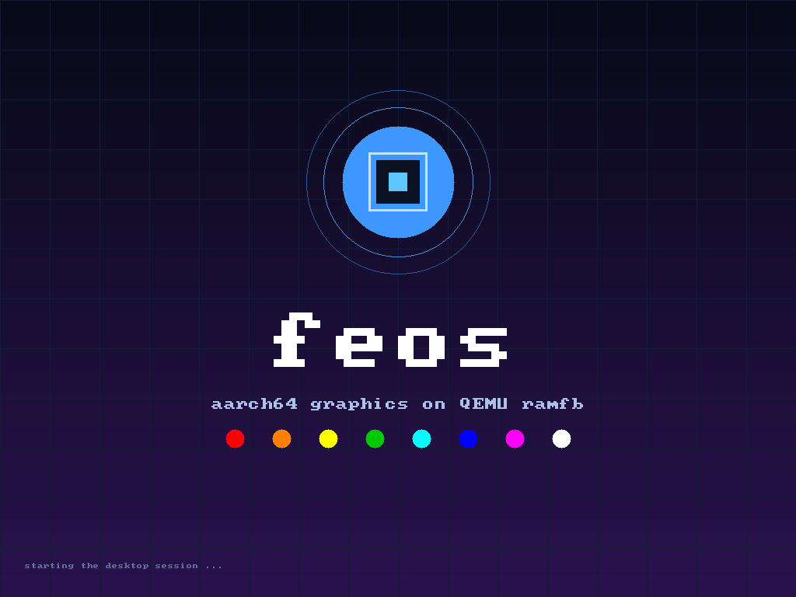
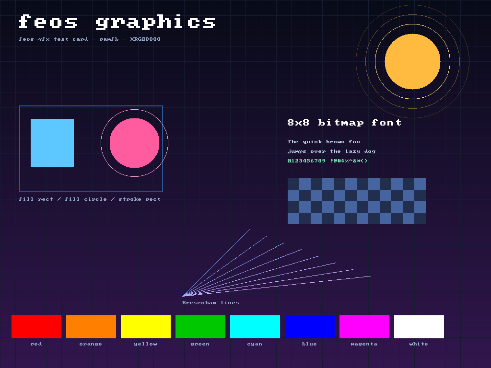

# feos

A tiny bare-metal **Rust** operating-system skeleton for the **aarch64** QEMU
`virt` machine, organised as a multi-crate workspace. It boots at EL1, installs
exception vectors, talks to the PL011 serial port, brings up a **ramfb**
framebuffer, draws a splash screen, starts a preemptive round-robin scheduler,
and drops into a small interactive shell.

Everything can be built and run inside Docker, so the only host requirement is
Docker.





## Why the workspace is split up

The project is designed to grow along four independent axes:

- **boards** — every machine gets a board support package in `boards/<name>`
- **drivers** — every device gets its own crate in `drivers/<class>/<name>`
- **libraries** — reusable, hardware-independent code lives in `libs/<name>`
- **apps** — every shell command is an app in `apps/`

Dependencies point in one direction only:

```
kernel  ->  boards  ->  drivers  ->  libs/hal
   |           |           |
   |           +---------> libs (gfx, console, ...)
   |
   +------>  arch (aarch64)  ->  libs/hal
   +------>  apps  ->  libs/app  ->  libs/hal
   |                    apps  ->  libs/gfx, libs/gui, libs/console
   +------>  libs/hal
```

Nothing points back up the stack: an architecture crate never knows about a
board, a driver never knows about the kernel, and an app never owns hardware.
That is what makes it possible to add a second board, a second display driver,
or a second shell app without touching unrelated code. The kernel's scheduler
is the one piece of policy that lives above the layers: it consumes the
architecture IRQ entry and the `Processes` service defined in `libs/app`.

Apps also never mention a real architecture or board. The kernel hands them a
`feos_app::Platform` containing the board facts and the `Clock`, `Power`, `Cpu`
and `Audio` implementations from the HAL, so the same app set runs on every
port.

`members` in the root `Cargo.toml` uses globs, so a new crate directory is
picked up by Cargo automatically. The only edits needed to wire it in are the
dependency edges (usually one line in a `Cargo.toml` and one line in a board or
app registry).

## Repository layout

```
.
├── Cargo.toml                  # virtual workspace manifest (no kernel code)
├── rust-toolchain.toml         # stable + aarch64-unknown-none target
├── .cargo/config.toml          # default target, rust-lld flags, cargo runner
├── Dockerfile                  # rust:1-slim-bookworm + qemu-system-arm
├── Makefile                    # build, run, test, Docker targets
├── scripts/
│   ├── qemu.sh                 # shared QEMU launch (ramfb + Intel HDA + display)
│   └── docker-run.sh           # container entry point: build, then boot
├── docs/                       # screenshots and architecture notes
│
├── kernel/                     # feos-kernel: the bootable binary (bin: feos)
│   └── src/
│       ├── main.rs             # kmain, IRQ handler, panic handler, wiring
│       └── sched.rs            # process table and round-robin scheduler
│
├── arch/
│   └── aarch64/                # feos-arch-aarch64
│       └── src/
│           ├── boot.S          # _start: CPU setup, BSS, jump to kmain
│           ├── vectors.S       # exception table + recoverable IRQ entry
│           ├── exceptions.rs   # vector install, FaultInfo, handler hook
│           ├── irq.rs          # TrapFrame, IRQ dispatch, mask helpers
│           ├── cpu.rs          # halt, current EL, MIDR
│           ├── psci.rs         # poweroff / reboot
│           └── timer.rs        # generic timer helpers
│
├── boards/
│   └── qemu-virt/              # feos-board-qemu-virt
│       ├── linker.ld           # 0x40080000 load address, BSS, 64 KiB stack
│       └── src/lib.rs          # MMIO map, UART/framebuffer/audio wiring, symbols
│
├── drivers/
│   ├── serial/pl011/           # feos-driver-pl011
│   ├── firmware/fw-cfg/        # feos-driver-fw-cfg
│   ├── display/ramfb/          # feos-driver-ramfb
│   ├── bus/pci/                # feos-driver-pci: PCIe ECAM + BAR assignment
│   ├── audio/intel-hda/        # feos-driver-intel-hda: Intel HDA playback
│   └── interrupt/gicv2/        # feos-driver-gicv2: GICv2 distributor + CPU interface
│
├── libs/
│   ├── hal/                    # feos-hal: device + system-service traits
│   ├── sync/                   # feos-sync: SpinLock and friends
│   ├── console/                # feos-console: registered console + macros
│   ├── gfx/                    # feos-gfx: dependency-free 2D graphics
│   ├── gui/                    # feos-gui: immediate-mode widgets, layout, charts
│   ├── audio/                  # feos-audio: PCM buffers, mixing, synthesis
│   └── app/                    # feos-app: App trait, Context, Platform
│
└── apps/
    ├── commands/               # feos-apps: built-in apps + registry
    │   └── src/
    │       ├── help.rs  echo.rs  info.rs  uptime.rs  sleep.rs
    │       ├── clear.rs  gfx.rs  splash.rs  tone.rs  power.rs
    │       ├── gui.rs          # feos-gui dashboard demo
    │       ├── spawn.rs  ps.rs  kill.rs  tick.rs
    │       ├── ui.rs           # splash screen and test card renderer
    │       └── lib.rs          # REGISTRY and find()
    └── shell/                  # feos-shell: line editor + dispatcher
        └── src/lib.rs
```

## Adding things

**A driver.** Create `drivers/<class>/<name>/` with a `Cargo.toml`, implement
the relevant trait from `feos-hal` (or add a new trait there), and let the board
instantiate it. Drivers take their MMIO base address as a constructor
argument; they never hard-code board addresses.

**A library.** Create `libs/<name>/`, keep it `no_std` and dependency-light,
and add it to `[workspace.dependencies]` if several crates need it.

**An app.** Add a module under `apps/commands/src/` whose unit struct
implements `feos_app::App`, then add it to `REGISTRY` in
`apps/commands/src/lib.rs`. Apps get `args`, the optional `Canvas`, and the
`Platform` services through `Context`; they do not depend on a board or
architecture crate.

**A board.** Copy `boards/qemu-virt/`, adjust the constants and devices, point
the kernel at it in `kernel/Cargo.toml`, and select the linker script from
`.cargo/config.toml` (or a per-board build flag). The kernel source does not
change.

**A new architecture.** Add `arch/<name>/` with the same public surface as
`arch/aarch64`, plus a board that uses it.

## Features

- `#![no_std]`, `#![no_main]` kernel with zero external dependencies
- Layered Cargo workspace: kernel, arch, board, drivers, libraries, apps
- Boot assembly: stack setup, BSS zeroing, FP/SIMD enable, secondary CPU parking
- PL011 UART driver behind a `Serial` HAL trait
- PCIe ECAM enumeration and BAR assignment, enough to bring up firmware-less
  PCI devices
- Intel HDA audio driver: CORB/RIRB command rings, codec discovery, and polled
  DMA playback through one output stream
- `feos-hal` device traits (`Serial`, `Audio`) and system-service traits
  (`Clock`, `Power`, `Cpu`) that keep apps board- and architecture-independent
- Registered console with `print!` / `println!` and panic-safe output
- AArch64 exception vector table with an ESR/ELR/FAR diagnostic dump, plus a
  recoverable IRQ entry that saves and restores a full 800-byte `TrapFrame`
- GICv2 driver behind an `InterruptController` HAL trait, with Group 0 and the
  timer PPI wired up by the board
- Preemptive round-robin scheduler: eight process slots, 16 KiB stacks, and a
  100 Hz generic-timer tick; the shell is PID 1
- `spawn`, `ps`, `kill`, and `tick` commands for running and inspecting
  background processes
- QEMU `ramfb` framebuffer: 1024x768 linear **XRGB8888** in guest RAM
- `feos-gfx`: a `no_std` 2D library with pixels, rectangles, Bresenham lines,
  circles, gradients, blitting, and an 8x8 bitmap font
- `feos-gui`: a `no_std`, allocation-free immediate-mode GUI toolkit with
  widgets, linear layout, scrolling, text input, charts, windows and dialogs
- `feos-audio`: a `no_std` 16-bit PCM library with sample buffers, saturating
  mixing, fades, and sine/square/triangle/sawtooth/noise synthesis
- `tone` shell command: synthesizes a chord with `feos-audio` and plays it
  through the HDA codec
- Boot splash and an interactive graphics test card
- Generic timer (`CNTPCT_EL0`) for uptime, busy-wait sleeps, and the scheduler
  tick (`CNTP_TVAL_EL0`)
- PSCI over `HVC` for clean `poweroff` / `reboot`
- Interactive serial shell with line editing (backspace, Ctrl-C)
- App registry with per-command crates/modules and aliases
- Host unit tests for the graphics, GUI, audio, and synchronization libraries
- Docker image containing Rust, QEMU with GTK (window) and VNC display support

## Quick start (Docker)

```sh
make docker-build
make docker-run
```

`make docker-run` opens a **real QEMU window** on your desktop while the serial
shell stays in your terminal. It grants QEMU temporary access to your X11 /
XWayland display (`xhost +si:localuser:<you>`), binds it in with
`-v /tmp/.X11-unix`, and revokes the access again when QEMU exits.

Requirements for the window: an X11 or Wayland (XWayland) session and a
`qemu-system-gui` build inside the image (already installed by the
`Dockerfile`). On Wayland the window appears through XWayland.

Then use the `gfx` command in the serial shell to redraw the test card,
`gui` to render the widget and chart dashboard, and `tone` to play an A-major
chord through the emulated Intel HDA codec. Use the `poweroff` command (or
`Ctrl-A` then `X`) to leave QEMU.

`make docker-run` wires the guest's HDA codec to a host backend. On Linux with
`/dev/snd`, the Makefile passes `--device /dev/snd` and QEMU uses ALSA, so
`tone` is audible on the default output. If there is no `/dev/snd`, QEMU
writes `target/audio/qemu.wav` at 48 kHz stereo instead; play that file on the
host to hear the same samples. See
[Hearing it](#hearing-it) for backend overrides.

### VNC instead of a window

For headless machines, SSH sessions, or a remote desktop, use:

```sh
make docker-run-vnc
```

This publishes QEMU's display over **VNC on port 5900**, using the same audio
backend rules as `make docker-run`. Connect from another terminal:

```sh
vncviewer localhost:5900
# or GNOME Connections / Remmina / TigerVNC: vnc://localhost:5900
```

Or run the image directly with an explicit backend:

```sh
docker build -t feos .
docker run --rm -it -p 5900:5900 -e FEOS_DISPLAY=vnc=0.0.0.0:0 feos
```

`FEOS_DISPLAY` selects the QEMU backend: `gtk` (window through the host X
server), `vnc=...` (VNC server), or `none` (serial only). The GTK backend needs
the X socket mount and `DISPLAY`; the Makefile handles both for you.

`make docker-shell` opens a shell with the source mounted and a named volume
for `target/`, so build artifacts are not written as root on the host:

```sh
make docker-shell
# inside:
cargo build --release
./scripts/qemu.sh
```

## Native build and run

Requirements: Rust (rustup) and `qemu-system-aarch64`.

```sh
rustup target add aarch64-unknown-none   # also declared in rust-toolchain.toml
cargo build --release
make run                                 # VNC on localhost:5900
```

`cargo build` builds the kernel because the workspace sets
`default-members = ["kernel"]`. Use `cargo build --workspace` to build every
crate.

On Debian/Ubuntu, QEMU comes from `qemu-system-arm`:

```sh
sudo apt install qemu-system-arm
```

Useful overrides:

| Command                              | Result                                    |
|--------------------------------------|-------------------------------------------|
| `make run`                           | VNC display on `127.0.0.1:5900`           |
| `FEOS_DISPLAY=gtk make run`          | Native GTK window (if QEMU has GTK)       |
| `FEOS_DISPLAY=none make run`         | Headless: serial console only             |
| `make run QEMU_DISPLAY=vnc=0.0.0.0:0`| VNC reachable from other machines         |
| `make run AUDIODEV=alsa,id=snd0`      | Live ALSA output (needs `/dev/snd`)       |
| `make run AUDIODEV=pa,id=snd0`        | Live PulseAudio/PipeWire output           |
| `make run AUDIODEV=wav,id=snd0,path=/tmp/qemu.wav` | Capture playback to WAV     |
| `make audio-demo`                    | Render the audio example WAV natively      |
| `make docker-audio`                  | Render the audio example WAV in Docker     |

The scripts pass `-net none` because the kernel does not use networking and
some distributions' QEMU packages omit the `efi-virtio.rom` file that the
default NIC would load.

## Shell commands

| Command       | Description                                          |
|---------------|------------------------------------------------------|
| `help`        | List registered apps and their aliases                |
| `echo <text>` | Print text back                                      |
| `info`        | Board, exception level, MIDR, timer, memory, display, audio |
| `gfx`         | Draw the graphics test card (`demo` is an alias)     |
| `gui`         | Draw the feos-gui dashboard (`desktop`, `dashboard`) |
| `splash`      | Redraw the boot splash                               |
| `tone [ms]`   | Play an A-major chord for `ms` (default 1500, max 3000; `play` alias) |
| `uptime`      | Milliseconds since the counter started               |
| `sleep <ms>`  | Busy-wait for the given number of milliseconds       |
| `spawn <cmd> [args]` | Run a registered command as a background process |
| `ps`          | List processes and their state (`procs`, `processes`) |
| `kill <pid>`  | Stop a background process (the shell cannot be killed) |
| `tick [count] [ms]` | Print periodic ticks; useful with `spawn`       |
| `clear`       | Clear the terminal (ANSI escape)                     |
| `poweroff`    | PSCI SYSTEM_OFF; QEMU exits (`shutdown` alias)       |
| `reboot`      | PSCI SYSTEM_RESET (`reset` alias)                    |

## Processes and scheduling

Processes in feos are **kernel threads**, not isolated user processes: they
share the kernel address space, all run at EL1, and each has its own 16 KiB
stack and saved register frame. The process table has eight slots in `.bss`;
slot 0 is the shell, which is always PID 1 and is never reused.

The board initializes a GICv2 and enables the EL1 physical timer PPI (IRQ 30).
The timer fires at 100 Hz, the architecture's IRQ stub saves a full `TrapFrame`
on the interrupted stack, and `kernel/src/sched.rs` swaps that frame for the
next runnable process's frame. Returning from the exception therefore resumes a
different process. Scheduling is a plain round-robin; there are no priorities
and no blocking wait queues.

Try it from the shell:

```text
feos> spawn tick 8 200
started pid 2: tick
feos> spawn tick 8 200
started pid 3: tick
feos> ps
  PID  STATE    NAME
*   1  running  shell
    2  ready    tick
    3  ready    tick
feos> kill 2
killed pid 2
```

The ticks from PIDs 2 and 3 interleave with the prompt because both apps are
busy-waiting and the timer preempts them. `spawn` looks the command up in the
normal app registry, so any command can run in the background. Background apps
receive their own argument string and the `Platform` services (clock, power,
CPU, audio, processes), but no framebuffer: graphics apps such as `gfx` and
`splash` should stay in the foreground. A process exits when its `App::run`
returns; the scheduler frees the slot on the next timer tick so it can be
reused by a later `spawn`.

## The graphics library

`feos-gfx` (in `libs/gfx/`) is a standalone `no_std` crate with no
dependencies. It draws into any `&mut [u32]` pixel buffer in XRGB8888 format:

```rust
use feos_gfx::{Canvas, Color, Rect};

let mut pixels = [0u32; 64 * 32];
let mut canvas = Canvas::new(&mut pixels, 64, 32, 64).unwrap();

canvas.clear(Color::rgb(8, 11, 24));
canvas.fill_rect(Rect::new(4, 4, 20, 10), Color::RED);
canvas.fill_circle(48, 16, 10, Color::YELLOW);
canvas.line(0, 31, 63, 0, Color::CYAN);
canvas.fill_vertical_gradient(
    Rect::new(30, 18, 30, 12),
    Color::NAVY,
    Color::PURPLE,
);
canvas.draw_text(4, 22, "hi feos", Color::WHITE, 1);
```

API summary:

- `Canvas::new(pixels, width, height, stride)` with clipping on every draw
- `clear`, `put_pixel`, `pixel`
- `fill_rect`, `stroke_rect`, `hline`, `vline`, `line`
- `circle`, `fill_circle`
- `fill_vertical_gradient`
- `draw_char`, `draw_text`, `text_width`, `text_height` (8x8 bitmap font)
- `blit` for packed XRGB8888 images
- `Color` with `rgb`, `from_u32`, channel accessors, constants, and `lerp`
- `Point`, `Size`, `Rect` geometry helpers

The library is host-testable:

```sh
make test
# equivalent to:
cargo test -p feos-gfx -p feos-gui -p feos-audio -p feos-sync --target x86_64-unknown-linux-gnu
```

## The GUI library

`feos-gui` (in `libs/gui/`) builds a small desktop toolkit on top of
`feos-gfx`. It is `no_std`, has no allocator, no `unsafe`, and no dependencies
beyond `feos-gfx`. The model is **immediate mode**: an app rebuilds its
interface every frame, widgets return a `Response`, and state that must survive
between frames lives in caller-owned structs.

```rust
use feos_gfx::{Canvas, Rect};
use feos_gui::InteractionState;
use feos_gui::prelude::*;

let mut pixels = [0u32; 480 * 320];
let mut canvas = Canvas::new(&mut pixels, 480, 320, 480).unwrap();
let theme = Theme::dark();
let input = Input::new();
let mut state = InteractionState::<8>::new();
let mut volume = 0.6f32;
let mut enabled = true;

let mut ui = Ui::new(&mut canvas, &theme, &input, &mut state);
ui.desktop_background(ui.canvas_rect());
let panel = Rect::new(24, 24, 280, 180);
ui.card(panel, "Settings", |ui| {
    ui.label_muted("APPEARANCE");
    ui.checkbox(&mut enabled, "Enable notifications");
    ui.slider(&mut volume, 0.0, 1.0);
    if ui.primary_button("Apply").clicked {
        // handle the click
    }
});
```

Key pieces:

- `Ui` — the frame handle. It owns a clipped `Painter`, the active theme,
  input, and interaction state. Widgets are inherent methods, so custom
  widgets can mix freely with the built-in ones.
- `InteractionState<N>` — fixed-capacity hover/active/focus/tab-order table
  and scroll offsets. It never grows; extra regions degrade gracefully.
- `LayoutStack` / `ui.column`, `ui.row`, `ui.grid` — deterministic linear
  layout. No constraint solver and no allocations.
- `Painter` — clipping, rounded rectangles, alpha blending, shadows, and
  text drawing/wrapping/ellipsis over `feos_gfx::Canvas`.
- `Input` / `Event` — pointer, wheel and keyboard events for a future board
  driver. The current QEMU board has no mouse or keyboard device, so the `gui`
  demo renders one frame from static state.
- Widgets — labels, headings, paragraphs, buttons, checkboxes, radios, toggles,
  sliders, progress bars, badges, separators, text fields with selection and
  UTF-8 editing, panels, cards, scroll areas, tabs, windows, dialogs, lists,
  tooltips, and a desktop background.
- Charts — line, area, bar and sparkline series over caller-provided slices.
- `WindowState` — draggable and resizable window geometry, also caller-owned.

Everything is fallible only at the edges: `Canvas::new` validates the buffer,
while widgets simply clip or skip work when there is no room.

```sh
make test-gui
# equivalent to:
cargo test -p feos-gui --target x86_64-unknown-linux-gnu
```

## The audio library

`feos-audio` (in `libs/audio/`) is the audio counterpart of `feos-gfx`: a
standalone `no_std` crate with no dependencies. It works on caller-provided
interleaved 16-bit PCM buffers, never allocates, and uses only integer math.

```rust
use feos_audio::{AudioBuffer, AudioFormat, Oscillator, Sample, Waveform};

let format = AudioFormat::mono(48_000).unwrap();
let mut samples = [0i16; 48_000];
let mut buffer = AudioBuffer::new(&mut samples, format).unwrap();

// Render a one-second 440 Hz sine wave at half volume.
let mut tone = Oscillator::new(Waveform::Sine, 440, Sample::from_i16(16_000));
buffer.render_oscillator(&mut tone, Sample::MAX);

// Layer a quieter square wave on top.
let mut second = Oscillator::new(Waveform::Square, 660, Sample::from_i16(6_000));
buffer.mix_oscillator(&mut second, Sample::MAX);

// Add short fades and mutate the whole buffer.
buffer.fade_in(480);
buffer.fade_out(480);
buffer.apply_gain(Sample::from_i16(24_000));
```

API summary:

- `AudioBuffer::new(samples, format)` over `&mut [i16]`, validating whole frames
- `frames`, `channels`, `sample_rate`, `duration_ms`
- `clear`, `sample`, `set_sample`, `frame`, `frame_mut`
- `write_frame`, `mix_frame` with saturating addition
- `mix` another buffer of the same format
- `apply_gain`, `fade_in`, `fade_out`, `peak`, `is_silent`
- `render_oscillator`, `mix_oscillator`
- `Sample`: signed 16-bit PCM with `from_i16` / `from_i8` / `from_u8` /
  `from_f32`, `raw`, `to_f32`, `magnitude`, `gain`, and saturating `mix`
- `AudioFormat`: sample rate plus mono/stereo constructors
- `Oscillator` + `Waveform`: sine, square, triangle, sawtooth, and noise with
  changeable frequency, amplitude, and phase reset

## The audio driver

The kernel boots with no PCI firmware, so `feos-driver-pci` enumerates QEMU's
PCIe ECAM window, sizes BAR0 of the Intel HDA controller (`8086:2668`), assigns
it `0x1000_0000`, and enables memory decoding plus bus mastering. The board
does this in `init_audio()` and hands the resulting `&dyn Audio` to apps
through `Platform`.

`feos-driver-intel-hda` then:

- resets the controller and points CORB/RIRB at static command rings
- discovers the audio function group, output DAC and output pin at runtime
  (QEMU's `hda-output` reports DAC 2, pin 3)
- programs 48 kHz/16-bit stereo, unmutes the DAC and enables the output pin
- plays one block at a time through output stream descriptor 4, polling the
  buffer-completion bit instead of using interrupts

The rings, buffer descriptor list and PCM buffer are owned by the board's
static `AUDIO` object, so playback needs no allocator. The MMU is off, so DMA
addresses are the buffers' identity-mapped virtual addresses. A block may hold
up to 288,000 interleaved samples (three seconds); longer blocks are rejected
with `AudioError::TooLong`.

`tone` fills a static 48 kHz stereo buffer with a 440 + 554 + 659 Hz chord,
applies fades, and calls `Audio::play`. `info` prints whether the device is
ready.

> QEMU's `hda-duplex` codec also exposes a capture path and fails to create its
> ADC voice on some hosts. The launcher therefore uses `hda-output`, which is
> playback-only and matches the driver.

### Hearing it

`make docker-run` and `make docker-run-vnc` start QEMU with an Intel HDA codec
and a host audio backend. At the prompt:

```sh
make docker-build
make docker-run
# feos> tone 1500
```

The backend is chosen by `AUDIODEV`:

| `AUDIODEV` | Effect |
|------------|--------|
| `alsa,id=snd0` (default when `/dev/snd` exists) | `--device /dev/snd`; QEMU opens the default ALSA output |
| `pa,id=snd0` | mounts `PULSE_SOCKET` and sets `PULSE_SERVER` |
| `wav,id=snd0,path=target/audio/qemu.wav,...` (default otherwise) | writes a WAV under `target/audio` |

The WAV backend is pinned to `out.frequency=48000,out.channels=2,out.format=s16`
so the capture matches the codec and is not resampled. Listen to or inspect it
with:

```sh
file target/audio/qemu.wav
aplay target/audio/qemu.wav
```

If ALSA reports a busy device, stop the program holding the output or select a
different backend:

```sh
make docker-run AUDIODEV=pa,id=snd0
make docker-run AUDIODEV=wav,id=snd0,path=target/audio/qemu.wav,out.frequency=48000,out.channels=2,out.format=s16
```

The WAV path is rewritten to `/out/...` inside the container and bind-mounted
back to `target/audio`.

The library alone can also be rendered without QEMU:

```sh
make docker-audio             # render inside the container
aplay target/audio/feos-tone.wav
```

`make docker-audio` uses the same Docker image as `make docker-run`, runs the
`tone` example with `cargo run`, and streams the WAV back to
`target/audio/feos-tone.wav` without booting QEMU. It works with rootless
Podman as well, and the file is owned by your host user. Use `paplay`,
`ffplay -autoexit`, or `afplay` instead of `aplay` if that is what your host
provides.

The same demo works without Docker:

```sh
make audio-demo               # native render to target/audio/feos-tone.wav
aplay target/audio/feos-tone.wav

# or directly, choosing your own path:
cargo run -p feos-audio --example tone --target x86_64-unknown-linux-gnu -- /tmp/tone.wav
```

Change the output path with `make audio-demo AUDIO_OUT=/tmp/tone.wav`. The
example renders a three-second 48 kHz/16-bit stereo A-major chord and prints
its peak level, so a non-zero peak confirms the DSP path ran.

## How the boot works

1. QEMU loads the ELF at `0x4008_0000` (from
   `boards/qemu-virt/linker.ld`) and starts at `_start` in EL1 with the MMU,
   caches, and interrupts off. `x0` holds the device tree pointer (the ELF
   loader passes 0 here, so the DTB is not used).
2. `arch/aarch64/src/boot.S` keeps only the boot CPU running, sets `sp` to
   `__stack_top`, enables FP/SIMD via `CPACR_EL1.FPEN`, zeroes `.bss`, and
   calls `kmain(dtb)`.
3. `kmain` asks the board to initialize the console (PL011 plus the console
   writer/reader registration), installs `VBAR_EL1`, and prints the banner.
4. The board looks up the writable fw_cfg item `etc/ramfb`, fills in a 28-byte
   big-endian `RAMFBCfg` (address, `XR24` fourcc, width, height, stride), and
   submits it through fw_cfg's DMA interface. The 3 MiB scanout buffer is a
   page-aligned `static` in the board crate's `.bss`.
5. `ramfb` scans out of guest RAM directly, so drawing is simply writing
   pixels; there is no flush or virtqueue. `feos-gfx` renders the splash into
   the canvas, then the shell can redraw the test card with `gfx`.
6. The board finds the Intel HDA controller through the PCIe ECAM window,
   assigns BAR0, enables bus mastering, and initialises the driver: reset,
   CORB/RIRB setup, codec discovery, 48 kHz stereo format. The shell receives
   the resulting `&dyn Audio` in `Platform`.
7. `kmain` installs the IRQ handler, asks the board to initialize the GICv2 and
   enable timer PPI 30, creates the shell as PID 1, and starts the 100 Hz tick.
   Unmasking IRQs is the point where the shell becomes preemptible.
8. Faults land in the vector table, which forwards a `FaultInfo` to the kernel's
   reporter: `ESR_EL1`, `ELR_EL1`, `FAR_EL1`, `SPSR_EL1`, and the stack
   pointer, then halts. IRQs take the separate recoverable path described above.
9. `poweroff` issues PSCI `SYSTEM_OFF` over `HVC`; QEMU exits.

## Notes and limitations

- The MMU and caches are still off; the framebuffer is accessed through the
  identity mapping.
- Resolution is fixed at 1024x768 and the buffer lives in the board's `.bss`
  (3 MiB).
- No double buffering, alpha blending, or hardware acceleration; the font is
  ASCII-only (non-ASCII falls back to `?`).
- Single core. All processes share one address space and run at EL1, so there
  is no memory protection or privilege boundary between them; a fault in any
  process halts the machine.
- Eight process slots including the shell, 16 KiB per spawned stack, and no
  heap. `spawn` copies at most 96 bytes of arguments into the process table.
- Round-robin has no priorities, blocking sleep, or wait/join. `sleep` and
  `tick` busy-wait and rely on preemption, and a process cannot wait for
  another to exit.
- Background processes get no framebuffer, and apps share crate-level statics:
  avoid running the same stateful app (for example `tone`, which owns a static
  PCM buffer) in two processes at once.
- Audio is playback-only and interrupt-free: one HDA output stream, fixed
  48 kHz/16-bit stereo, no hardware volume or jack detection, and a three-second
  maximum block while the driver waits for completion. The scheduler can
  preempt the polling loop, but the HDA stream keeps running and playback
  resumes when the `tone` process is next scheduled. QEMU's `hda-output`
  codec is required (`hda-duplex` has a capture path that can fail to start).
- Debian's `qemu-system-arm` prints
  `Could not open option rom 'vgabios-ramfb.bin'` when `ramfb` starts. That ROM
  is x86 firmware and is unused on aarch64; the warning is harmless.

Natural extensions: identity-map the kernel with caches enabled, add an EL0
user mode with per-process page tables and a syscall boundary, add blocking
sleep/wait queues and priorities to the scheduler, support GICv3/ITS, implement
a bump allocator, add a `virtio-gpu` driver for larger modes, add
interrupt-driven HDA playback with a mixer and hardware volume control, or
parse the device tree. Each of these fits into an existing layer: `libs/` for
the allocator and scheduler policy, `drivers/` for GICv3, virtio-gpu and audio,
and `apps/` for an animation or audio app.

## License

MIT OR Apache-2.0.

The 8x8 bitmap font data in `libs/gfx/src/font.rs` is the public-domain
`font8x8_basic` table by Daniel Hepper, based on Marcel Sondaar's public-domain
IBM VGA font.
