# feos

`feos` is a bare-metal, `no_std` operating system written in Rust for two QEMU machines:
**AArch64 `virt`** and **x86_64 `q35`**. It's a monolithic, preemptive, multi-core kernel
with an XP-style desktop, a Bash-compatible shell with POSIX core utilities, a TCP/IP
stack, writable FAT32, exFAT and native filesystems, a media player with its own audio and
video decoders, FeAmp (a classic-style MP3 player with MilkDrop visualisations),
isolated user programs in ring 3 / EL0, and FEOS-DOS, an x86 virtual machine
and DOS that runs real protected-mode DOS games.

Everything from the boot code to the codecs is in this repository; the only host requirement
for building and running it is Docker (or Rust and QEMU).

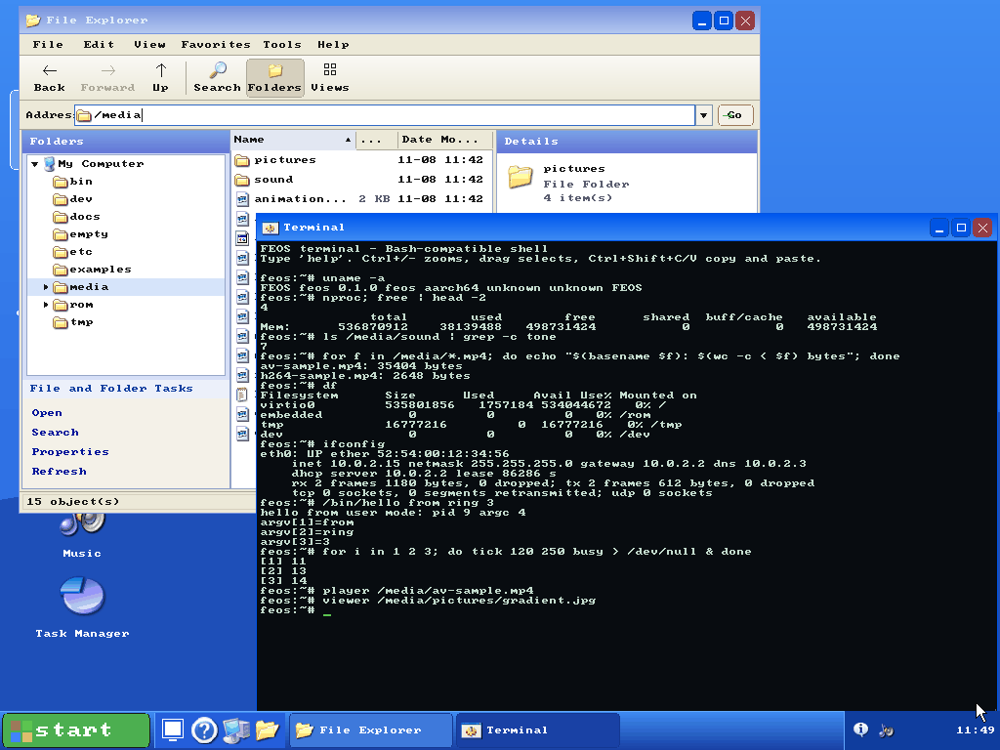

<p align="center">
  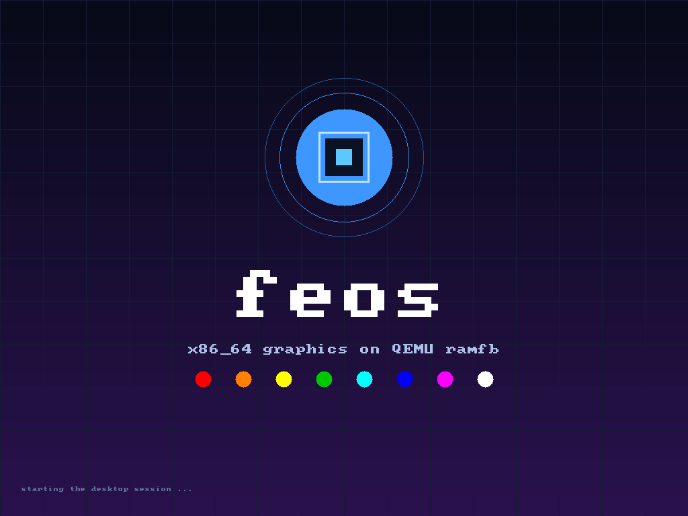
  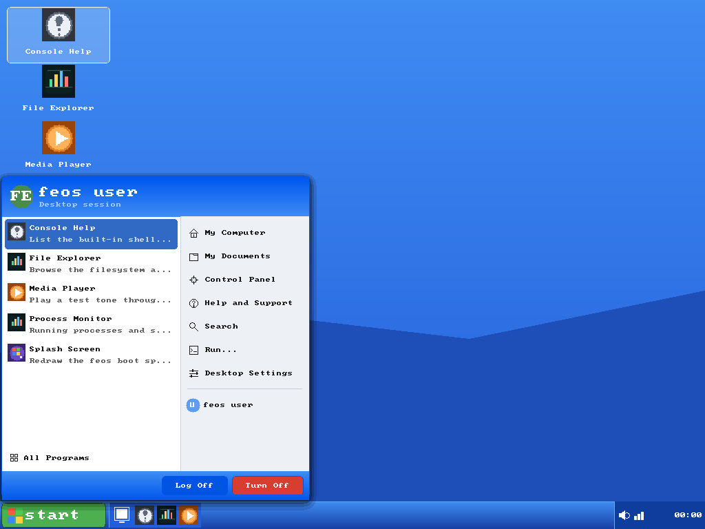
  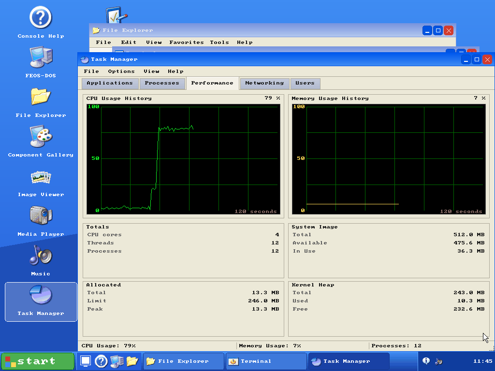
</p>

## Contents

- [Highlights](#highlights)
- [Quick start](#quick-start)
- [Screenshots](#screenshots)
- [FeAmp and MilkDrop](#feamp-and-milkdrop)
- [Features](#features)
- [Command reference](#command-reference)
- [Media formats](#media-formats)
- [FEOS-DOS](#feos-dos)
- [Developing](#developing)
- [Repository layout](#repository-layout)
- [Known limitations](#known-limitations)
- [Licensing](#licensing)

## Highlights

| Area | What's there |
|------|--------------|
| Kernel | SMP up to 8 CPUs on both ports, 32 process slots, priorities 0-15, CPU affinity, one-shot timers, guard pages, fault containment per task |
| Isolation | Separate ELF programs in `/bin` at EL0 / ring 3, each with its own page tables, a checked system call ABI and uid/gid permissions |
| Hardware | virtio blk, net, gpu and input; ramfb; UEFI GOP framebuffer; xHCI USB (keyboard, mouse, tablet, mass storage); Intel HDA playback and capture; PS/2; PL031 and CMOS RTCs; GICv2, GICv3 and LAPIC/IOAPIC with MSI/MSI-X |
| Boot | QEMU `-kernel` (ELF on AArch64, multiboot on x86_64), or UEFI through its own loader (OVMF, AAVMF); device tree, ACPI and multiboot parsing |
| Storage | FAT32, exFAT and a journalled native filesystem read-write, FAT12/16 read-only, MBR and GPT, a RAM root when there's no disk, changes synced about once a second |
| Network | Ethernet, ARP, IPv4, ICMP, UDP, TCP, DHCP and DNS; `ifconfig`, `ping`, `nslookup`, `wget`, `nc` |
| Desktop | Windows XP-style session: taskbar, Start menu, window manager, six colour schemes, an iconset and the XP cursor set, live resolution changes, settings that persist |
| Apps | FeAmp with a 10-band EQ and playlist, MilkDrop visualiser, File Explorer with content search, Terminal, Task Manager, Settings, Media Player, Music, Image Viewer, Component Gallery, System Information, FEOS-DOS |
| Shell | Bash-compatible language (functions, pipelines, redirection, here-docs, arithmetic, `[[ ]]`, traps, job control) and about 80 utilities |
| Media | H.264 (incl. High 10, 4:2:2, interlaced), VP8, MPEG-1, MJPEG, GIF; AAC/HE-AAC, Opus, MP3, FLAC, Vorbis, WAV, AIFF, AU; PNG, JPEG, BMP, ICO, QOI |
| FEOS-DOS | 386 interpreter with protected and virtual-8086 mode, x87, DPMI 0.9 host, VCPI, XMS/EMS, VGA/VESA, OPL3 and Sound Blaster 16 |

## Quick start

### With Docker

```sh
make docker-build
make docker-run-arm        # AArch64 virt (`make docker-run` is the same)
make docker-run-x64        # x86_64 q35
```

Both open a QEMU window on your X11 or Wayland (XWayland) desktop, with the serial shell in
the terminal. The window needs `DISPLAY` set; the Makefile grants QEMU access to it with
`xhost` for as long as QEMU runs. Without a desktop, serve the display over VNC on
`127.0.0.1:5900`:

```sh
make docker-run-vnc        # AArch64 (`docker-run-vnc-arm` is the same)
make docker-run-vnc-x64
vncviewer localhost:5900
```

**Sound.** The Docker targets pick the QEMU audio backend from `DOCKER_AUDIODEV`. Unless
`AUDIODEV` is given on the command line, that's `pa,id=snd0` (PulseAudio or PipeWire) when
the socket `PULSE_SOCKET` (default `/run/user/<uid>/pulse/native`) exists, and otherwise the
same default as `make run`: ALSA when there's a `/dev/snd`, or a WAV file in `target/audio`.

| `AUDIODEV` | Effect |
|------------|--------|
| `pa,id=snd0` | Mounts `PULSE_SOCKET` into the container and passes it to QEMU as `server=` |
| `alsa,id=snd0` | Passes `--device /dev/snd`; QEMU opens the default ALSA output, which a desktop may hold busy |
| `wav,id=snd0,path=target/audio/qemu.wav,...` | Writes a 48 kHz stereo WAV under `target/audio`, bind-mounted from `/out` |

```sh
make docker-run AUDIODEV=pa,id=snd0
make docker-run AUDIODEV=wav,id=snd0,path=target/audio/qemu.wav,out.frequency=48000,out.channels=2,out.format=s16
```

The image can also be run directly. `FEOS_ARCH` is `arm` (the default) or `x64`, and
`FEOS_DISPLAY` is `gtk`, `vnc=...` or `none`:

```sh
docker run --rm -it -p 127.0.0.1:5900:5900 -e FEOS_ARCH=x64 -e FEOS_DISPLAY=vnc=0.0.0.0:0 feos
```

`make docker-shell` opens a shell in the image with the tree mounted at `/src`, and
`make docker-boot-test` runs the boot test there with no network.

### On the host

You need the toolchain in `rust-toolchain.toml` (`rustup show` installs it), QEMU
(`qemu-system-aarch64`, `qemu-system-x86_64`) and `objcopy` for the x86_64 image. On
Debian or Ubuntu: `sudo apt install qemu-system-arm qemu-system-x86 binutils`.

```sh
make run-arm               # build and boot AArch64 (`make run`); VNC on 127.0.0.1:5900
make run-x64               # build and boot x86_64; VNC on 127.0.0.1:5900
```

Both build the user programs first, then a release kernel with LTO. They boot 4 CPUs and
512 MiB by default, with an Intel HDA codec and a virtio disk image,
`target/feos-disk-<arch>.img`, created sparse at 512 MiB and formatted by the kernel on first
boot, so files survive reboots (`FEOS_DISK=none` boots with a RAM root instead).

| Override | Result |
|----------|--------|
| `make run QEMU_DISPLAY=gtk` | A native QEMU window, if QEMU has GTK |
| `make run QEMU_DISPLAY=none` | Serial console only |
| `make run QEMU_SMP=8 QEMU_MEM=1G` | Eight CPUs and 1 GiB (`QEMU_SMP_X64` for `run-x64`) |
| `make run AUDIODEV=pa,id=snd0` | Live PulseAudio/PipeWire output |
| `make run QEMU_EXTRA="-netdev user,id=n0 -device virtio-net-pci,netdev=n0"` | A network card: the run scripts otherwise boot with `-net none` |
| `make run QEMU_EXTRA="-device virtio-gpu-pci"` | A virtio-gpu, used instead of ramfb |
| `FEOS_MACHINE=virt,gic-version=3 ./scripts/qemu.sh <kernel>` | AArch64 with a GICv3 |

On AArch64 the run target adds a virtio tablet and keyboard (`POINTER_FLAGS`,
`KEYBOARD_FLAGS`); x86_64 has PS/2. `cargo run` goes through the same scripts, which read
`FEOS_DISPLAY`, `FEOS_SMP` and `FEOS_MEM` instead.

### Booting from UEFI

`make build-efi` builds the loader for both architectures (`boot/efi`). Put it on a FAT
ESP as `\EFI\BOOT\BOOTAA64.EFI` or `\EFI\BOOT\BOOTX64.EFI`, with a kernel ELF beside it as
`\feos.elf`, and boot OVMF or AAVMF from it. The loader asks GOP for a 1024x768
framebuffer, passes the memory map, ACPI RSDP and device tree to the kernel, and jumps to it.
The `efi` phase of `scripts/boot-test.py` (`make_esp` and `efi_command`) does exactly this.

### First steps

The kernel shows a splash, then the desktop. Click **start**, or double-click an icon.
`Ctrl-\` on the serial console (or **Log Off**) leaves the desktop for the serial shell, and
`desktop` goes back. Some things to try in a Terminal or the serial shell:

```sh
ps; nproc; free; df
spawn tick 8 200          # a background task; `kill <pid>` ends it
player /media/av-sample.mp4
play /media/sound/tone.flac
ifconfig; ping -c 3 10.0.2.2
/bin/hello from ring 3
dosbox                    # FEOS-DOS
poweroff
```

## Screenshots

All taken from the current kernels under QEMU at 1024x768.

| | |
|---|---|
| 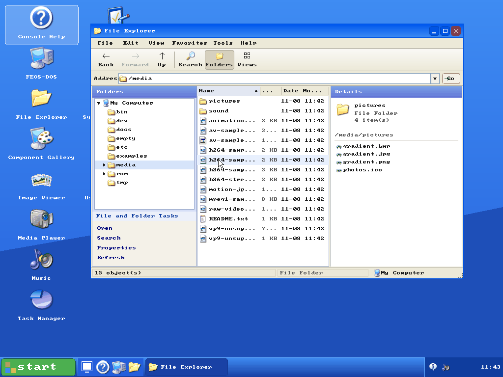 **File Explorer** browsing the sample media, with the folder tree and details pane |  **Task Manager** while three busy tasks share four CPUs |
| 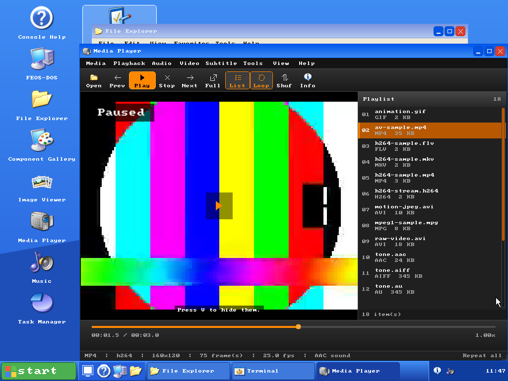 **Media Player** paused on an H.264 MP4 with AAC sound and SRT subtitles | 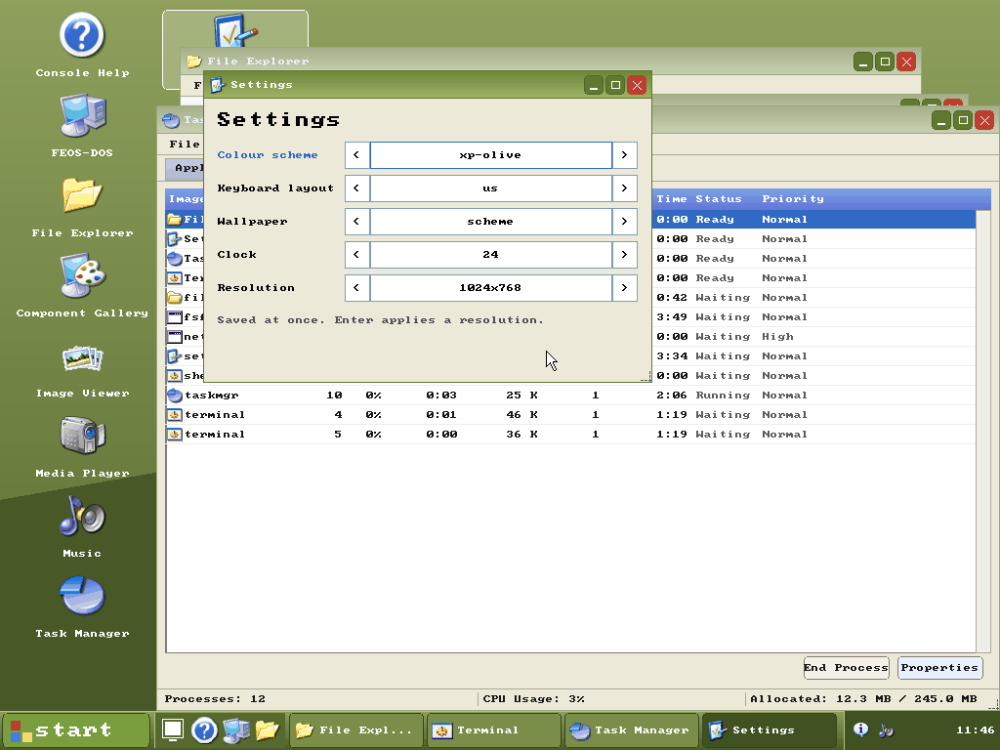 **Settings** switching the whole desktop to the olive scheme |
| 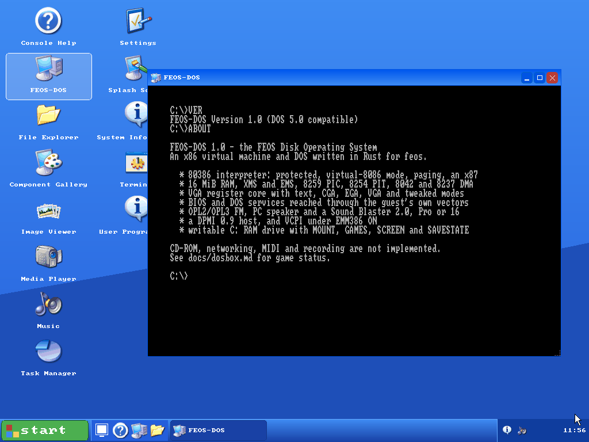 **FEOS-DOS** on the x86_64 port | 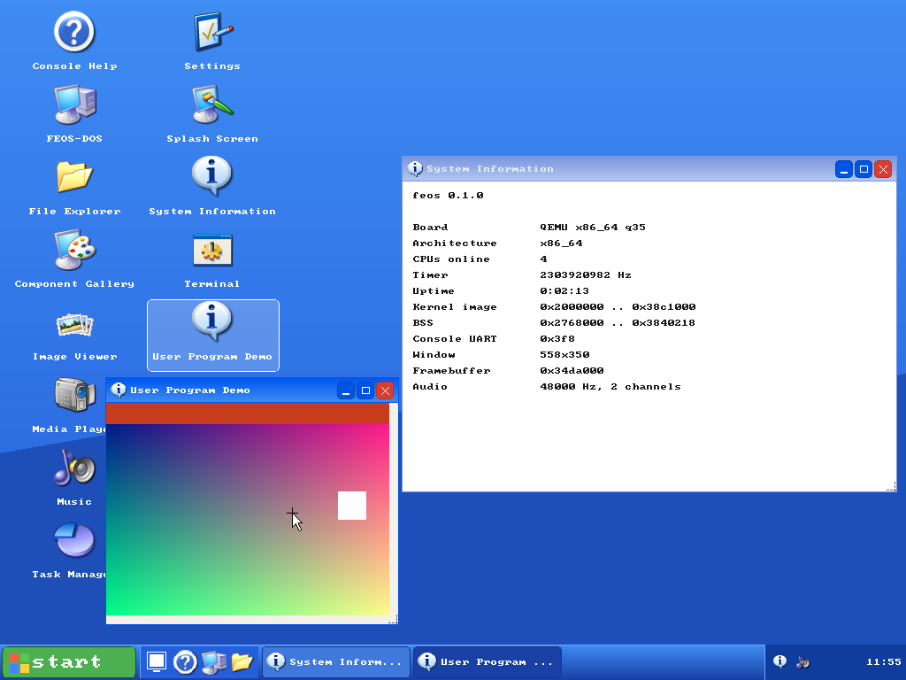 A **ring-3 user program** (`/bin/wdemo`) drawing its own window, and System Information, on x86_64 |
| 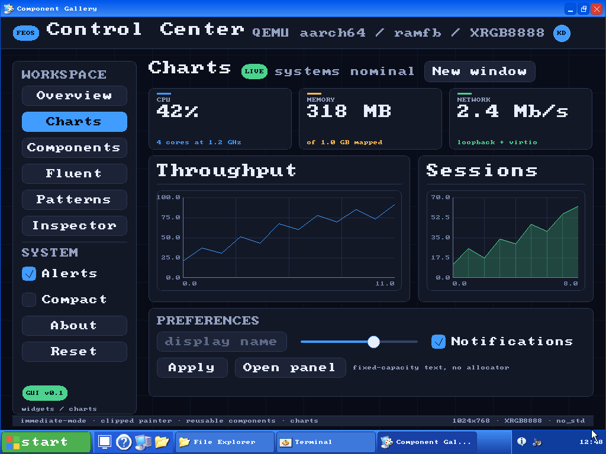 The **Component Gallery**, `feos-gui`'s widgets and charts with demo data | 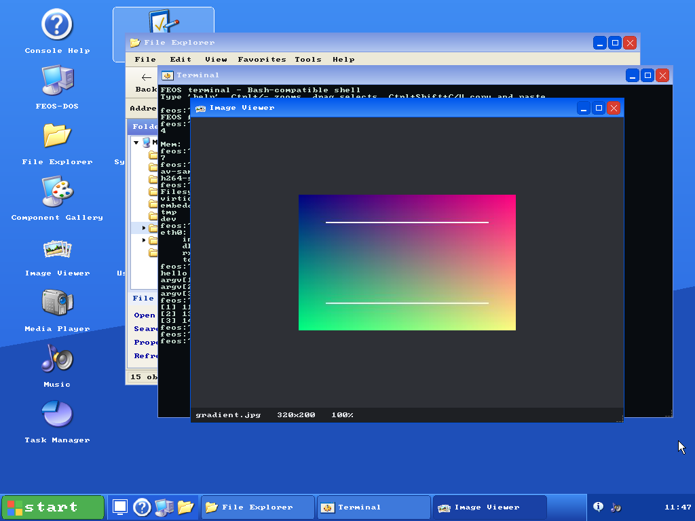 **Image Viewer** showing a JPEG |
| 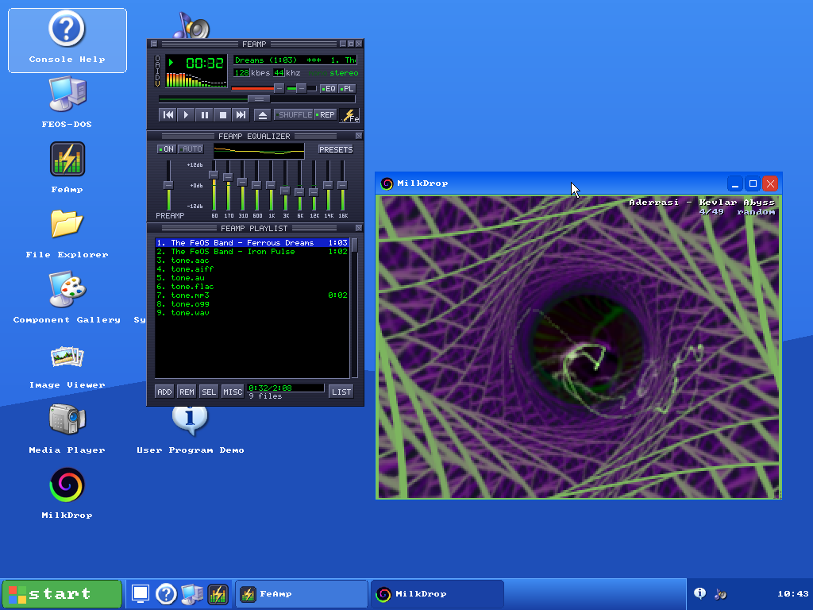 **FeAmp** playing with the equalizer and playlist open, beside **MilkDrop** | 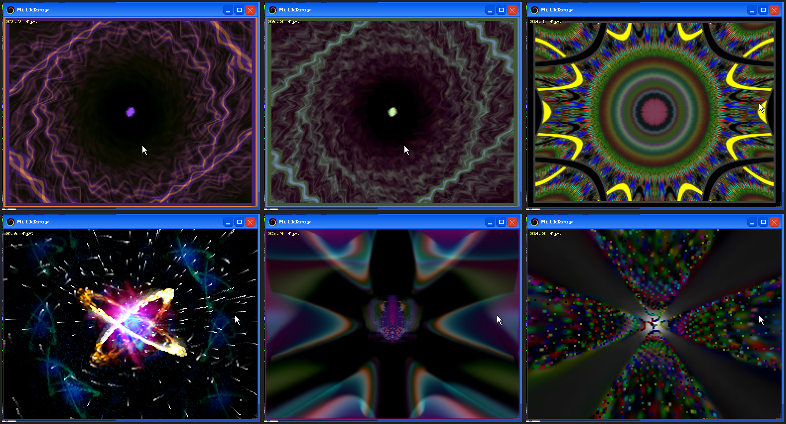 Six **MilkDrop** presets, each with its frame rate |

## FeAmp and MilkDrop

> *It really whips the crab's shell!*


**FeAmp** is a love letter to the late-90s desktop music player, written from scratch in Rust
on `feos-gfx`. It has the classic three-panel stack:
the main window with a green LED clock, scrolling title, bitrate and spectrum analyser; a
10-band graphic equalizer that really filters the sound; and a playlist that reads ID3v2
tags. The window has no frame and draws its own title bars, so you can drag, shade,
double-size and minimise it. Every pixel of the skin is drawn in code. There are no bitmaps.

<table>
<tr>
<td width="38%">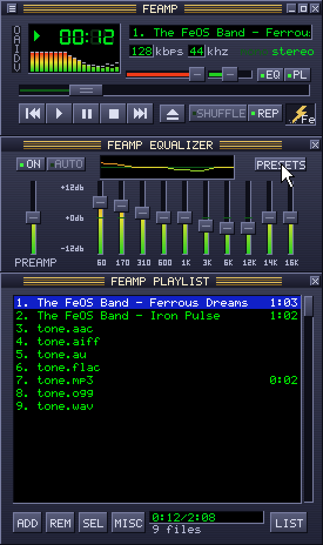</td>
<td>

- **Transport**: `Z X C V B` for previous, play, pause, stop and next, as fingers remember them;
  seek bar, volume and balance with the value shown in the title display while you drag
- **Equalizer**: 10 bands from 60 Hz to 16 kHz at ±12 dB, preamp, a curve preview and
  presets (Rock, Pop, Dance, Techno, ...), applied in the audio task as RBJ peaking filters
- **Playlist**: every sound file on the system, artist and title from ID3v2 (2.2 to 2.4),
  durations from Xing headers, shuffle, repeat, sort, add and remove
- **Visualiser**: click the spectrum to cycle spectrum, oscilloscope and off; `Ctrl+K` opens MilkDrop
- **Demo tracks**: two original synthesised songs by "The FeOS Band" in `/media/music`

</td>
</tr>
</table>

**MilkDrop** brings the visualisations. Winamp's vis plugins are Windows x86 DLLs and can't
run here, so `feos-milkdrop` is an engine for the presets themselves. It has an EEL2
expression compiler, per-frame and per-pixel equations on a 40x30 warp mesh, a
feedback-warp renderer in fixed point, waveforms, custom waves and shapes, motion vectors,
borders and video echo. It all runs in software on the CPU, fed by FFT beat detection
on the mixer's output. 49 classic presets by Geiss, Rovastar, Krash, Aderrasi, Unchained and
others ship in `/media/milkdrop`; drop any `.milk` file there and it shows up.


| Key | MilkDrop |
|-----|----------|
| `Space` / `N` / `→` | next preset (a click does too) |
| `Backspace` / `P` / `←` | previous preset |
| `R` | random order |
| `L` | lock the current preset (otherwise it moves on every 20 seconds) |
| `Enter` | show the preset's name |
| `F` | show the frame rate |
| `F1` | help |

Start them from the Start menu, the desktop icons, or a Terminal with `feamp` and
`milkdrop`. Details are in [`docs/feamp.md`](docs/feamp.md).

## Features

### Kernel

- **Two ports behind one interface.** The kernel calls the CPU and machine only through the
  `feos_hal::Arch` and `feos_hal::Board` traits, so both ports build from the same source.
  AArch64 boots at EL1 (dropping from EL2 or EL3 when started there) with the MMU and caches
  on; x86_64 enters long mode from multiboot with SSE/x87 state saved per task.
- **SMP.** Up to 8 CPUs: PSCI `CPU_ON` (HVC or SMC, from the device tree) with GICv2 or
  GICv3 on AArch64, ACPI MADT and INIT/SIPI with the LAPIC and IOAPIC on x86_64. Each CPU
  has its own interrupt stack and a one-shot timer.
- **Scheduler.** 32 slots, priorities 0-15 (default 8), round-robin among equals with aging
  so nothing starves, affinity masks (`taskset`), a home CPU per task with work stealing,
  and blocking sleeps and futex-style waits. A trap saves straight into the task's frame,
  so a switch is a pointer change. See [the scheduler](docs/architecture.md#the-scheduler).
- **Memory.** RAM from the device tree, multiboot map or UEFI memory map into a frame
  allocator; a heap sized from what's found (at least 64 MiB when it fits). Task stacks
  are 256 KiB with unmapped guard pages below them.
- **Failure.** A fault or panic in a task holding no lock ends only that task (status 139);
  a hung or crashed desktop app closes its window and the desktop carries on. Anything else
  stops every CPU with a report. See [When something fails](docs/architecture.md#when-something-fails).
- **User programs.** Static ELF binaries in `/bin` run at EL0 / ring 3 in their own address
  space (ASIDs, PAN/UXN/PXN on AArch64; NX, SMEP, SMAP on x86_64). The kernel never
  dereferences a user pointer: `feos-vm` walks the tables and copies. Programs get files,
  pipes, `mmap`, a futex, a window surface, and a uid/gid enforced on the native filesystem.
  See [User programs](docs/architecture.md#user-programs).
- **Interrupts.** One handler table for both ports, wired lines and message-signalled
  interrupts (MSI-X, MSI, GICv2m). virtio-blk, virtio-net and xHCI are interrupt-driven.

### Drivers

| Class | Drivers |
|-------|---------|
| Interrupts | `gicv2`, `gicv3` (AArch64), `apic` (x86_64) |
| Serial | `pl011` (AArch64), `uart16550` (x86_64) |
| Display | `ramfb` (via `fw-cfg`), `virtio-gpu` (live mode changes), the UEFI GOP framebuffer |
| Storage | `virtio-blk` (MMIO or PCI), USB mass storage through `xhci` |
| Network | `virtio-net` (MMIO or PCI) |
| Input | `virtio-input` tablet, mouse and keyboard; `i8042` PS/2 (x86_64); USB HID through `xhci` |
| Sound | `intel-hda`: streaming playback and capture |
| Clock | `pl031` (AArch64), `cmos` (x86_64) |
| Bus | `pci` (ECAM and legacy ports, BAR assignment), `virtio-core` (MMIO and PCI transports) |

### Filesystems and storage

All shells, Terminals and File Explorer share one tree. The first disk with a filesystem is
the root, later ones `/disk<n>`, native filesystems `/native<n>` and USB sticks `/usb<n>`; a
blank disk is formatted as FAT32 (or exFAT if too small) and seeded from the embedded image.
With no disk the root is a RAM copy of that image. `/tmp` and `/dev` are always in RAM.

- **FAT32 and exFAT**, read-write, with a dirty flag and a check at mount after a crash;
  **FAT12/16** read-only.
- **The native filesystem**: inodes with owners, modes and times, hard and symbolic links,
  and a redo journal. `fsck` checks it from the guest. See
  [the native filesystem](docs/architecture.md#the-native-filesystem).
- **Permissions** apply to user programs on native filesystems (`/bin/runas`, `permtest`);
  kernel-linked apps run as root.
- MBR and GPT partitions, a buffer cache, and `fsflush` syncing about once a second.

### Networking

`feos-net` is a TCP/IP stack written for feos: Ethernet, ARP, IPv4, ICMP echo, UDP, DHCP, DNS
and TCP with RFC 6298 retransmission, congestion control, out-of-order reassembly and
zero-window probes. The `netd` task drives it, and the boot test pushes 8 MiB each way over
every interrupt transport. See [`docs/networking.md`](docs/networking.md).

### Desktop

A Windows XP-style session configured by `apps/desktop/desktop.yaml`: wallpaper and desktop
icons, a taskbar with quick launch, task buttons, a volume control and clock, a two-column
Start menu with All Programs, Run and Turn Off, and a window manager with focus, drag, resize
from any edge, minimise, maximise and `Alt+Tab`. Applications are single-file `.fapp`
bundles (ZIP or TAR, a YAML manifest and icons), discovered at boot or installed at run time
with `appinstall`.

- **Settings**: colour scheme (`xp-blue`, `xp-olive`, `xp-silver`, `dark`, `light`,
  `high-contrast`), keyboard layout, wallpaper, clock and screen resolution, from 640x480 to
  1920x1080, applied live with a 15-second revert prompt. Saved to `/etc/desktop.conf`.
- **Icons and cursors**: every picture comes from the iconset in `assets/icons`; the pointer
  is the Windows XP cursor set, with resize, text, link and animated busy cursors.
- **Font**: one 8x8 font with about 590 glyphs: ASCII, Latin-1, Latin Extended-A, Greek,
  Cyrillic, box drawing and block elements, and wide-character cell widths in the Terminal.
- **File Explorer**: menus, toolbar, address bar with history, folder tree, view modes,
  preview pane, new folder, cut, copy, paste, rename and delete, and search by name or
content on a background task.
- **Input**: virtio, PS/2 or USB keyboard and pointer, with the wheel, plus the serial
  console as a keyboard.

See [`docs/desktop.md`](docs/desktop.md) for configuration, bundles and keyboard shortcuts.

### Shell

The serial console and every Terminal window run the same Bash-compatible shell: quoting,
parameter expansion with the `${}` operators, command substitution, arithmetic, globbing,
pipelines whose stages run concurrently, every redirection form including here-docs and
here-strings, `if`/`for`/`while`/`until`/`case`, functions with `local`, `[[ ]]`, `set -euxo
pipefail`, `trap`, `time`, `&`, `jobs`/`fg`/`bg`/`wait` and Ctrl-Z, with a line editor,
history, Ctrl-R search and Tab completion. The Terminal adds zoom, selection and a clipboard.
See [`docs/terminal.md`](docs/terminal.md).

## Command reference

`help` lists everything, and `help <command>` shows usage.

**Shell builtins:** `.` `:` `alias` `bash` `bg` `break` `builtin` `cd` `clear` `command`
`continue` `declare` `eval` `exec` `exit` `export` `false` `fg` `getopts` `help` `history`
`jobs` `kill` `let` `local` `pwd` `read` `readonly` `return` `set` `sh` `shift` `source`
`timeout` `trap` `true` `type` `typeset` `unalias` `unset` `wait` `which`

**Core utilities** (`feos-coreutils`; aliases `dir`, `xxd`, `nano`, `more`):

```
[         appinstall arch     awk      base64   basename cat      chmod
chown     cmp      comm     cp       cut      date     dd       df
diff      dirname  du       echo     edit     env      expr     false
file      find     fold     free     fsck     grep     gunzip   gzip
head      hexdump  hostname id       less     ln       ls       mkdir
mktemp    mount    mv       nl       nproc    od       paste    printenv
printf    pwd      readlink realpath rev      rm       rmdir    sed
seq       sha256sum sort    split    stat     strings  sync     tac
tail      tar      tee      test     touch    tr       tree     true
uname     uniq     uptime   wc       whoami   xargs    yes      zcat
```

**Applications and system commands** (`apps/commands`, the desktop and FEOS-DOS):

| Area | Commands |
|------|----------|
| Desktop | `desktop` (`wm`): the session, or `list`, `status`, `run <id>`, `menu`, `service ...`; `settings` |
| Windows | `terminal` (`term`), `files` (`explorer`), `taskmgr` (`task-manager`, `tm`), `player` (`media-player`, `video`) `[--speed] [path]`, `music [file]`, `viewer <file>` (`image-viewer`), `feamp`, `milkdrop` (`visualizer`), `gui` (Component Gallery), `dosbox` (`dos`, `feos-dos`) |
| Processes | `ps`, `spawn <command> [args]`, `kill [-SIGNAL] <pid>`, `renice <priority> <pid>`, `taskset <mask> <pid>`, `tick [count] [ms] [busy]`, `sleep <ms>` |
| Sound | `play [--at seconds \| --speed] <file>`, `rec <seconds> <file.wav>`, `tone [ms]` |
| Network | `ifconfig` (`ip`) `[-s]`, `ping [-c n] [-s size] <host>`, `nslookup <name>`, `wget [-O file] <url>`, `nc [...] <host> <port>`, `nc -l [-k] [...] <port>` |
| System | `info`, `coreutils [command]`, `gfx` (test card), `splash`, `poweroff`, `reboot` |
| Kernel tests | `ktest <uspawn \| user-memory \| cpus \| fp \| irqs \| mem \| priority \| affinity \| timer \| panic \| overflow \| overflow-locked \| null \| task-panic>` (some stop the machine on purpose) |

**User programs** in `/bin`, run by path: `hello`, `cat`, `wdemo` (a windowed program),
`runas <uid> <gid> <program>`, and the test programs `utest`, `vmcheck`, `spin`,
`permtest` and `malicious`.

## Media formats

The Media Player plays video and sound files from any mounted filesystem, streaming large
files from disk rather than loading them, with a playlist (M3U save and load), seeking,
aspect modes, fullscreen, SRT subtitles picked up by name, and speeds where sound between
half and double speed keeps its pitch. Music plays sound files; Image Viewer shows pictures.
All decoders are in-tree, `no_std`, bounded in memory and fuzzed on the host.

| Kind | Format | Notes |
|------|--------|-------|
| Video | **H.264** | Baseline (no FMO), Main, High, High 10 and High 4:2:2; progressive, field-coded and MBAFF; CAVLC and CABAC. Output is 8-bit 4:2:0, fields are woven, not deinterlaced. 4:4:4, lossless, FMO and SP/SI are refused |
| | **VP8** | Written from RFC 6386 |
| | **MPEG-1** video | Elementary and program streams, with Layer II sound in a program stream |
| | **Motion JPEG**, uncompressed RGB/YUV, RLE4/RLE8 | |
| | **GIF** (animated) | Read whole, up to 16 MiB |
| Containers | MP4/MOV (incl. fragmented), Matroska/WebM, AVI (incl. OpenDML), FLV, IVF, Annex-B H.264, MPEG program streams | HEVC, VP9, AV1, MPEG-2/4 Part 2, Theora and others are recognised and described, but not decoded |
| Sound | **AAC** | LC, Main, LTP, HE-AAC (SBR) and HE-AAC v2 (parametric stereo), in ADTS, MP4 or Matroska |
| | **Opus** | SILK, CELT and hybrid, up to 8 channels, in Ogg, Matroska or MP4 |
| | **MP3**, MPEG Layers I and II | Seeks (and ADTS AAC's) land exactly only at a constant bit rate; otherwise they're estimated, from a Xing table when there is one |
| | **FLAC** (native and Ogg), **Ogg Vorbis** | FLAC is output at 16 bits |
| | **WAV** (PCM, float, A-law, µ-law), **AIFF/AIFF-C**, **AU** | WAV is also written by `rec` |
| Pictures | PNG (incl. Adam7), JPEG (baseline and progressive, CMYK), BMP, ICO, CUR, ANI, PNM, QOI | |

Sound goes through `feos-mixer`, which mixes up to 8 streams at 48 kHz, converting each from
its own format, with master volume and mute. `rec` records from the HDA codec's input, which QEMU's `hda-duplex` or
`hda-micro` provides (the run scripts use `hda-output`, which has none). Archives and
compression (ZIP, TAR, gzip, DEFLATE), JSON and YAML have their own crates too. See
[the video path](docs/architecture.md#the-kernel-heap-and-video-path) and
[the audio path](docs/architecture.md#the-audio-path).

## FEOS-DOS

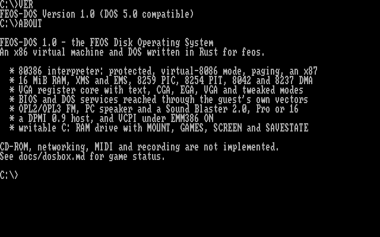

FEOS-DOS (`libs/dosbox`) is an x86 PC and DOS written for the kernel. Open it from the Start
menu or run `dosbox`.

- **CPU**: an 80386 interpreter with some 486 instructions; real, protected and
  virtual-8086 mode, paging, rings, gates and task switches; a 387-class x87 with 80-bit
  arithmetic.
- **Machine**: 640 KiB plus 15 MiB extended, A20, XMS 3.0, EMS 4.0, a DPMI 0.9 host,
  VCPI under `EMM386 ON`; PICs, PIT, 8042, DMA; CGA/EGA/VGA with a register-level core
  and VESA banked modes `100h`/`101h`; PC speaker, OPL2/OPL3 and a Sound Blaster 16, Pro
  or 2.0; mouse.
- **DOS**: a DOS 5-compatible `INT 21h` with a real process model, and a `COMMAND.COM`-style
  prompt with batch files. `C:` is a 40 MiB RAM drive; `MOUNT` extracts a game ZIP onto it.
- **Games**: all 13 titles in the shareware/demo library (`data/games`, linked in with
  `make run-games`) start and reach play or their menus, including DOOM, Duke Nukem 3D,
  Quake, Warcraft II and Super Street Fighter II Turbo. The per-title table is in
  [`docs/dosbox.md`](docs/dosbox.md#game-status).
- **Gaps**: no pipes at the prompt, CD-ROM, GUS, MIDI or VESA linear frame buffers; `DPMI ON`
  fails Warcraft II's sound and `32RTM`; a guest's own `EMM386.EXE` hasn't been run. See
  [`docs/dosbox-gap.md`](docs/dosbox-gap.md).

## Developing

### Build and check

```sh
make build-arm             # target/aarch64-unknown-none/release/feos (`make build`)
make build-x64             # target/x86_64-feos/release/feos
make build-efi             # the UEFI loaders
make check-arm             # type-check every crate for one port (`make check`)
make check-x64
make clippy                # both ports and the user programs, warnings as errors
```

The default cargo target is `aarch64-unknown-none`. The x86_64 kernel uses the custom
hard-float target `arch/x86_64/x86_64-feos.json`, which builds `core` from source, so every
x86_64 build goes through `scripts/cargo-x64.sh` (see the script for why). A plain
`cargo check --workspace` fails, because each port's crates contain that port's assembly:
use the `check-*` targets. `make user-arm` and `make user-x64` build the user programs into
`user/out/<arch>`, which the kernel embeds as `/bin`; `make build-*` does this first.

### Test

```sh
make test                                                      # every host test crate
make test-gui                                                  # one crate: test-<name>
cargo test -p feos-gui --target x86_64-unknown-linux-gnu      # the same by hand
make fuzz                                                      # fuzz tests, optimised with overflow checks
make boot-test                                                 # boot both kernels headless and drive them
FEOS_BOOT_TEST_ONLY=smp ./scripts/boot-test.py arm target/aarch64-unknown-none/release/feos
```

Host tests need `--target`, as the default target is bare metal. Libraries are
`#![cfg_attr(not(test), no_std)]` and tested on the host; parsers of untrusted input are
fuzzed with a failing allocator and a small stack. Kernel code is tested by booting:
`scripts/boot-test.py` has phases for storage, SMP, IRQs, RAM sizes, faults, the scheduler,
GICv3, networking, USB, UEFI, exception levels, user programs, settings, resolution changes
and more, and `scripts/media-boot-test.py` checks real audio output and input.
`.github/workflows/ci.yml` runs the checks, tests, clippy, fuzz and the boot tests.

### Architecture

```
kernel ──> boards/<board> ──> drivers/<class>/<name> ──> libs/hal
   │             └──> boards/common
   ├────> arch/<arch> ──> libs/hal
   └────> apps/* ──> libs/* (through feos_app::Platform; never hardware)
```

Dependencies point one way. Drivers never print or hard-code addresses, libraries never
depend on a board, driver or the kernel, and apps reach the machine only through
`feos_app::Platform`: clock, power, CPU, audio, pointer, keyboard, processes, memory, the
app registry, the filesystem and the network. Inversions keep it that way: architecture
crates call handlers the kernel registers, and libraries find apps by name through the
`AppRegistry` trait. A new driver, library, app or board is one crate plus one dependency
edge. [`docs/architecture.md`](docs/architecture.md) covers the layers, interrupt and
scheduling paths, user programs, the GUI, memory, booting, USB and the media, audio and
filesystem paths.

**Adding an app**: a unit struct implementing `feos_app::App` in `apps/commands/src/`,
listed in `REGISTRY`. For a Start-menu entry, add a bundle source in
`apps/desktop/bundle-src/<id>/` whose manifest `entry` names the command, then
`make bundles`. **Adding a user program**: a file in `user/src/bin/` and its name in
`USER_BINS` in the `Makefile`.

## Repository layout

```
arch/aarch64/       EL1 entry and EL2/EL3 drop, vectors, MMU, PSCI, generic timer
arch/x86_64/        multiboot and EFI entry, long mode, IDT/GDT/TSS, SIPI trampoline,
                    and the x86_64-feos.json target
boards/qemu-virt/   AArch64 virt: memory map, devices, linker script (image at 0x4020_0000),
                    and fs/, the embedded filesystem image
boards/qemu-x86_64/ x86_64 q35: devices, linker script (image at 0x200_0000, 32 MiB)
boards/common/      what both boards share: display, disks, USB, IRQ routing, image build
boot/efi/           the UEFI loader (feos-efi)
drivers/            audio/intel-hda  block/virtio  bus/pci  display/{ramfb,virtio-gpu}
                    firmware/fw-cfg  input/{i8042,virtio}  interrupt/{apic,gicv2,gicv3}
                    net/virtio  rtc/{cmos,pl031}  serial/{pl011,uart16550}  usb/xhci
                    virtio/core
kernel/             boot wiring, scheduler, SMP, memory, heap, user programs, fatal
                    policy, ktest
libs/               hal app console sync irq sched heap frames firmware bootinfo
                    abi elf vm                      kernel support and user programs
                    fs archive compress source      storage and archives
                    net                             TCP/IP
                    gfx gui desktop iconset init bundle keys text json yaml
                    image video h264 audio audio-codec opus mixer
                    sh coreutils                    shell
                    math milkdrop                   floating-point maths, MilkDrop engine
                    dosbox                          FEOS-DOS
                    port-io
apps/commands/      the app registry: Terminal, Explorer, Task Manager, Media Player, ...
apps/shell/         the shell's console and registry adapter
apps/desktop/       the desktop session, desktop.yaml, bundle-src/ and apps/*.fapp
apps/dosbox/        the FEOS-DOS window and serial front end
user/               the user-program workspace: runtime, link.ld, src/bin/
assets/             icons/ (the iconset), cursors/ (the XP cursor set), and music/ and
                    milkdrop/ (mounted at /media/music and /media/milkdrop)
data/games/         the DOS game library and its exFAT image
scripts/            run, build, boot-test, disk and table-generation scripts
docs/               architecture, desktop, terminal, networking and FEOS-DOS references
```

## Known limitations

- **QEMU only.** Real hardware has never been booted. The EL2/EL3 entry, PSCI conduit and
  UEFI paths are implemented and tested under QEMU only, and on AArch64 the kernel needs a
  device tree, not ACPI alone.
- **Kernel-linked apps aren't isolated.** The shell, desktop and apps share the kernel's
  address space and privilege; only `/bin` programs are behind the user/kernel boundary.
  Those have one thread each and no `fork`, `exec`, signals or shared memory.
- **A killed task's heap isn't reclaimed** (KRN-7): it's tracked and reported, as freeing it
  by owner could free memory something shared still uses.
- **One scheduler lock, one disk request.** Per-CPU queues are policy under one lock, and
  virtio-blk keeps one request in flight because the VFS has a single lock.
- **Devices.** No USB hubs or hot plug; no MSI on GICv3 (it would need an ITS driver);
  HDA capture needs a codec with an input.
- **Networking** is IPv4 with one interface, no IP fragments, no window scaling and no
  HTTPS, and its sequence numbers aren't cryptographically random.
- **Text** is one 8x8 font: CJK shows as boxes, and combining marks and right-to-left text
  aren't handled.
- **Media**: VP9, AV1, HEVC and MPEG-2/4 aren't decoded; GIF isn't streamed; CELT-only Opus
  conceals lost packets with noise.
- **FEOS-DOS** gaps are listed [above](#feos-dos), and whether the bundled game data may be
  redistributed is still the owner's review (DOS-7).

## Licensing

Most crates are `MIT OR Apache-2.0` (`LICENSE-MIT`, `LICENSE-APACHE`). `feos-dosbox`,
`feos-dosbox-app` and the kernel crate are `GPL-2.0-or-later` (`COPYING`), because FEOS-DOS
contains code derived from rust-dos and an LGPL Nuked-OPL3 port, and the kernel links it
statically: **the `feos` binary is GPL-2.0-or-later as a whole.** Third-party code (the
H.264, MP3 and Opus decoder ports, MPEG-1 from PL_MPEG, codec tables, font data) is listed
with its licence in [`LICENSING.md`](LICENSING.md).

Not covered by those licences:

- **Cursors** (`assets/cursors`): the "Windows XP" set from rw-designer.com, whose readme says
  "License: Demo" and requires a purchased licence for anything but evaluation. They were
  included by the project owner's decision; settle those terms or replace them before
  distributing the repository or a kernel built from it.
- **Icons** (`assets/icons`): supplied by the owner as open for inclusion, unconfirmed.
- **MilkDrop presets** (`assets/milkdrop`): by their named authors, from the original
  MilkDrop preset pack as kept by projectM; see
  [`assets/milkdrop/README.txt`](assets/milkdrop/README.txt). FeAmp's name, skin and demo
  music are original to this project.
- **Games** (`data/games`): third-party shareware, demos and freeware under each title's own
  terms; see [`data/games/README.md`](data/games/README.md).
