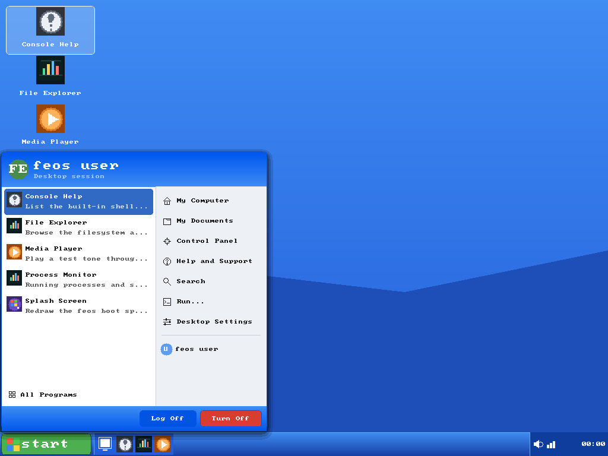

# The feos desktop



`feos-desktop` is the session layer on top of `feos-gui`: wallpaper, desktop
shortcuts, an XP-style taskbar and Start menu, a window manager, and a small
init/service supervisor. It is configured with YAML and discovers applications
from an *application folder* of single-file bundles.

## Booting into the desktop

On a graphical boot the kernel draws the splash, waits 1.5 seconds, and then
starts the desktop automatically. Because the QEMU board has no pointer or
keyboard device, the serial console supplies the keyboard events:

| Key | Action |
|-----|--------|
| Arrow keys | Move the Start-menu highlight, or the wallpaper selection when the menu is closed |
| `Enter` | Launch the highlighted application |
| `Space` | Open the Start menu; toggle All Programs while it is open |
| `Tab` | Toggle All Programs, or focus the next window when the menu is closed |
| `Esc` | Close the Start menu |
| `Ctrl-\` | Leave the desktop and return to the serial shell (`Ctrl-D` also works) |

The Start menu starts open on boot (`start_menu.initially_open`), so pressing
`Enter` launches the first application, and the arrow keys walk the list. The
Start menu's "Log Off" button behaves like `Ctrl-\`.

Run the same session from the shell:

```text
feos> desktop
[desktop] session started
[desktop] arrows select, Enter launches, Space opens Start, Esc closes, Ctrl-\ returns to the shell
[desktop] 7 application(s) discovered in the application folder (0 skipped)
```

Other forms are useful on a serial-only boot:

| Command | Description |
|---------|-------------|
| `desktop` | Run the interactive desktop session (`session` and `boot` are aliases) |
| `desktop list` | List discovered applications |
| `desktop status` | Print configuration, windows and service state |
| `desktop run <id>` | Open and launch an application by bundle id |
| `desktop menu` | Render with the Start menu open (demo/screenshots) |
| `desktop service <action> <id>` | Start, stop or restart one supervised service |
| `wm` | Alias for `desktop` |

## Layout

```
libs/desktop/src/
├── lib.rs          # Desktop session: frames, launching, init integration
├── config.rs       # YAML schema and parsing
├── theme.rs        # xp-blue, xp-olive, xp-silver, dark, light, high-contrast
├── paint.rs        # wallpaper, icon scaling, clock formatting, Start flag
├── taskbar.rs      # Start button, quick launch, task buttons, tray
├── start_menu.rs   # pinned apps, all-programs grid, commands, power footer
└── window.rs       # z-order, focus, move/resize, minimize/maximize

libs/init/          # restart policies and service supervision
libs/bundle/        # .fapp reader: manifest, icon, catalog scan
apps/desktop/       # the `desktop` app, YAML file and embedded app folder
```

The desktop library is allocation-free, `no_std`, and has no dependency on the
kernel or the board. `Desktop::render` returns a `DesktopResponse`; the caller
decides how a launch request becomes a process. That is what lets the whole
session be tested on the host.

## Configuration

The shipped configuration lives in `apps/desktop/desktop.yaml` and is embedded
with `include_str!`. A board with a filesystem can read its own file and pass
the string to `DesktopConfig::parse` instead.

```yaml
theme: xp-blue            # xp-blue, xp-olive, xp-silver, dark, light, high-contrast

wallpaper:
  style: gradient         # gradient, solid, grid
  top: "#3f8cf3"
  bottom: "#245edb"
  accent: "#549cf6"       # grid lines

taskbar:
  position: bottom        # bottom or top
  height: 40
  start_label: start
  show_clock: true
  clock_24h: true
  show_quick_launch: true
  quick_launch_count: 3
  show_desktop: true

start_menu:
  width: 448
  height: 470
  columns: 2
  show_descriptions: true
  initially_open: true

desktop:
  show_icons: true
  icon_size: 48
  show_labels: true

windows:
  default_width: 560
  default_height: 380
  cascade: 24

apps:
  directories:
    - apps/desktop/apps
  extensions:
    - .fapp

init:
  restart: on-failure     # never, on-failure, always
  max_restarts: 3
  autostart:
    - process-monitor
```

Unknown keys and invalid values keep their defaults, so a newer configuration
still boots on an older build. Malformed YAML is reported by
`DesktopConfig::parse`.

`init.autostart` ids are resolved through the catalog first (a bundle id such
as `terminal`) and then through the shell registry (a command such as `ps`).
Ids that resolve to nothing appear in `desktop status` as `missing`.

## Application bundles

An application is one compressed file — a ZIP or TAR archive — with everything
it needs inside:

```text
my-app.fapp
├── manifest.yaml
├── icon.bmp           # BMP, PNG, JPEG, PPM or QOI, up to 48x48
└── ...                # additional resources
```

`manifest.yaml`:

```yaml
id: terminal
name: Terminal
version: 1.0.0
entry: gui            # command in the shell registry
category: System
description: GUI dashboard and component gallery
icon: icon.bmp
args: ""
window:
  width: 760
  height: 520
```

The scanner detects bundles from their archive magic, not from the file
suffix, so a renamed bundle still shows up. Files that are not archives are
ignored; malformed bundles are counted as skipped. Duplicate ids are rejected
after the first bundle wins.

Pack a directory with:

```sh
scripts/pack-app.py apps/desktop/bundle-src/terminal apps/desktop/apps/terminal.fapp
```

or repack every source directory:

```sh
make bundles
```

### The application folder

On the QEMU port there is no block device yet, so the application folder is
embedded in the kernel image. `apps/desktop/build.rs` turns every file in
`apps/desktop/apps/` into a `DirEntry` with `include_bytes!`. Adding a bundle
there and rebuilding is enough for it to appear in the Start menu — no code,
registry entry or configuration change.

A board with a filesystem passes the same `&[DirEntry]` list to
`Desktop::scan`, and can call it again whenever the folder changes. Detection
is dynamic in both cases; only the source of the bytes differs.

## Window manager and taskbar

`WindowManager` is a fixed-capacity table (`MAX_WINDOWS`, default 8). Windows
cascade from the top-left of the work area, are clamped so they stay reachable,
and support focus, z-order, drag, resize, minimize, maximize and restore. The
taskbar reflows to a bottom or top edge and sizes its buttons from the open
window count.

`Desktop::launch(index, registry, processes)` opens the window first, resolves
the manifest entry point through `AppRegistry`, and spawns it through
`Processes`. An unknown entry leaves the window open with an explanation
instead of failing silently. An app that returns `true` from
`App::foreground` (currently the File Explorer) is run synchronously by the
desktop session so it can draw full-screen and read the keyboard; the desktop
closes its window and redraws when the app returns. The serial console feeds
`feos_gui::Input` events through the desktop app's session loop; a pointer
driver can use the same path and forward `DesktopResponse::launch`.

The boot session composes frames into the board's off-screen back buffer and
copies the finished frame to the ramfb scanout in one pass. It also redraws
only when input arrives, the clock minute changes, a service or window state
changes, or a launch needs a new frame, so an idle desktop leaves the scanout
buffer alone.

## Init process manager

`libs/init` supplies `Init<N>`, a fixed-capacity supervisor:

- register services by id with an `App` and arguments,
- start, stop and restart by id,
- record ids that have no app as `missing`,
- restart according to `never`, `on-failure` or `always`,
- stop retrying after `max_restarts`,
- expose `ServiceStatus` snapshots for a `ps`-style table.

The desktop creates one supervisor from the `init` section, registers
autostart entries in `start_session`, and calls `tick_session` once per frame.
The API is independent of the desktop, so a serial-only board can use it
directly.
