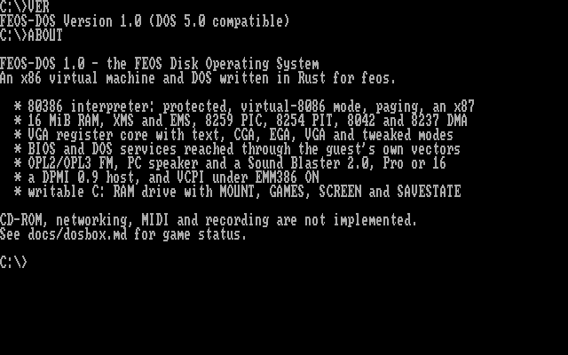

# FEOS-DOS



`feos-dosbox` is FEOS's DOS box: a `no_std` x86 virtual machine and DOS, written
for the kernel's `no_std` + `alloc` constraints. See [Licensing](#licensing) for
where its code comes from.

## Running it

From the desktop, open **FEOS-DOS** in the Start menu. From the serial shell:

```text
dosbox
```

The desktop opens a 720x500 window; the screen (640x400, or 640x480 for 480-line
modes) is centred and scaled by an integer factor. `EXIT` at the prompt (or
closing the window) returns to the desktop. `Ctrl-\` leaves the full-screen
serial session.

The prompt starts on `C:`, a RAM drive: files you create there last until the DOS
window closes. `README.TXT`, `AUTOEXEC.BAT`, `HELLO.COM` and `BOX.COM` are created
at boot. `HELLO.COM` and `BOX.COM` are hand-assembled images, so `DEMO` proves the
CPU, DOS and VGA paths end to end. `MOUNT` brings directories and game ZIPs from
the FEOS filesystem onto `C:`.

## What is emulated

| Part | Details |
|------|---------|
| CPU | 80386 interpreter, plus the 486's `BSWAP`, `XADD`, `CMPXCHG`, `INVLPG`, `INVD` and `WBINVD`. Real mode, big real mode, 16- and 32-bit protected mode, privilege rings, call and interrupt gates, hardware task switches, the IDT, paging and virtual-8086 mode with IOPL checks and the I/O bitmap. FLAGS and `PUSH SP` identify it as a 386; there's no `CPUID`. Undefined opcodes raise `INT 6`. |
| Interrupts | Real-mode `INT`, hardware interrupts and exceptions all go through the guest's IVT, which starts out pointing at ROM stubs of the form `<callback n>; IRET`. Programs can hook and chain any vector. |
| FPU | 387-class x87 with true 80-bit arithmetic, rounding and precision control, exception flags with the masked responses, all the load, store and BCD forms, and the transcendentals in software. Unmasked exceptions set the status flags but aren't delivered. |
| Memory | 640 KiB conventional, the HMA and 15 MiB of extended memory, allocated in 64 KiB chunks as it's first written. A real A20 gate through the 8042, port `92h`, XMS and `INT 15h`. XMS 3.0 and LIM EMS 4.0 (page frame at `D000h`). A memory manager with VCPI (`EMM386 ON`). No upper memory blocks. |
| Chips | Two 8259 PICs, an 8254 PIT (modes 0-5, latches and read-back), an 8042 with make and break scan codes on port `60h` and `IRQ 1`, and both 8237 DMA controllers. |
| Timing | Guest time follows retired instruction units: 3000 per guest millisecond by default (`CYCLES n` changes it). `REP` iterations count, and services report their cost. Idle guests skip to the next timer event. |
| BIOS | `INT 08h`, `09h`, `10h`-`17h`, `1Ah`, a full keyboard ring and shift state in the BDA, model byte `FCh`, date, configuration table and font pointers. |
| Video | Text modes, CGA 4/5/6, EGA `0Dh`/`0Eh`/`10h`, VGA `11h`/`12h`/`13h`, and tweaked modes through a register-level core: latches, write modes 0-3, read modes 0-1, chain-4 on or off, CRTC start address and offset, double scan, panning, the attribute controller and DAC. VBE 2.0 banked modes `100h` and `101h`, with the palette call and the protected-mode interface (`4F09h`, `4F0Ah`), without a linear frame buffer. Displays wider than 640 are clipped. |
| Keyboard | Make and break codes, `E0` prefixes, BDA ring, `INT 16h` and the DOS console calls. Key releases come through from the desktop, so held keys work. |
| Mouse | `INT 33h`, virtual-screen coordinates, the hide counter, and handlers through `IRQ 12`. |
| Joystick | The game port's timing and buttons, with `SystemBus::joystick`. The front end has no joystick to feed it, so it reads as absent. |
| Sound | PC speaker through PIT channel 2, including bit-banged port `61h`. OPL2/OPL3 FM (Nuked-OPL3) with timers that run on guest time and writes placed at the right sample. A Sound Blaster at `220h`, `IRQ 7`, DMA 1 and 5: an SB16 by default (DSP 4.05, 8- and 16-bit stereo, CT1745 mixer), or a Pro (DSP 3.02, stereo through mixer `0Eh`, CT1345 mixer) or a 2.0 with `SBTYPE`. Voice and FM go through the card's mixer, and everything goes to the desktop's mixer through a non-blocking stream. OPL generation stops once no voice is sounding, until the next register write. Recording plays silence. No GUS, MT-32 or MIDI. |
| DOS | DOS 5 compatible `INT 21h`: an MCB arena with allocation strategies, PSPs with job file tables over a shared system file table, `4Bh` load-and-exec, load-only and overlay, `4Dh`, `31h` and `INT 27h`, FCB calls, `6Ch`, `5Ah`, `5Bh`, `59h`, `38h`, `65h`, device names, directory search with its state in the DTA, country and case tables, the list of lists and `InDOS`. |
| Drive | One writable RAM drive, `C:`, with unique generated 8.3 names, a 40 MiB quota and fallible allocation. |
| Prompt | `COMMAND.COM`-style built-ins, `PATH`, `SET`, `<`, `>`, `>>`, and batch files with `%0`-`%9`, `%VAR%`, `IF` (`ERRORLEVEL`, `EXIST`, `==`, `NOT`), `GOTO`, `FOR`, `CALL`, `SHIFT` and `PAUSE`. Pipes aren't implemented. |

### DOS extenders, DPMI and VCPI

`INT 2Fh AX=1687h` finds the machine's own DPMI 0.9 host ([`dpmi.rs`](../libs/dosbox/src/dpmi.rs)), so a
program with no extender of its own runs. Clients run at level 3 with IOPL 3 and paging
off, so linear addresses are physical. It has the `INT 31h` functions of 0.9, `AX=0504h`
from 1.0, raw switches, real-mode callbacks, exception handlers and clients nesting.
`INT 21h` with selectors is translated for the common calls, as Windows and Borland's
servers do it, and `INT 2Fh AX=168Ah` answers `MS-DOS`.

`DPMI AUTO` is the default: the host keeps quiet to a program whose image says it brings
an extender that doesn't need one (`DOS/4G`, and Borland's `32rtm`), so those stay on the
path they run best on. `DPMI ON` offers it to everyone and `DPMI OFF` to no one. DJGPP
programs use the host, and don't need the `CWSDPMI.EXE` beside them: Quake and Snood were
run with that file deleted.

`EMM386 ON` runs the programs started after it in virtual-8086 mode under a monitor in the
machine ([`emm386.rs`](../libs/dosbox/src/emm386.rs)), which offers VCPI through `INT 67h AX=DExx`. There
are no guest tables at level 0: interrupts go straight to the guest's vector table, because
the program has IOPL 3. A privileged instruction the monitor can't emulate ends the program
with a message, which is what happens to an extender that doesn't know VCPI. A guest's
own monitor, such as a real `EMM386.EXE`, would use the CPU's virtual-8086 mode with real
tables; that path has CPU tests only, because no such program was to hand.

Known gaps in the host: with `DPMI ON`, Warcraft II reports no digital sound card and
exits, and `32RTM` fails its loader (`Can't find ''`). Neither is seen on `AUTO`, where they
use DOS/4GW and `DPMI32VM`. Why Warcraft II differs isn't known.

### The guest can't take the host down

A guest can't panic the kernel or stall it unboundedly: instruction length is
capped, `REP` runs in bounded chunks and resumes, services charge their work to
the budget, memory and drive allocations are fallible and bounded, and save states
are validated in full. The fuzz tests run random code, registers, memory and
`INT` calls in dev builds. The machine runs on its own task (`dos-vm`), watched by the window: if
the host can't keep up, a paced frame is capped at 40 ms of guest time and the
guest slows down instead.

## Commands for the game library

The repository ships a 64 MiB exFAT image with one ZIP per shareware, demo or
freeware DOS game at `data/games/dos.img`. Keeping one ZIP per title avoids
thousands of loose files in `data/games/dos`. It was built with the FEOS exFAT
writer:

```text
truncate -s 64M data/games/dos.img
mkfs.exfat -n FEOSDOS -c 32K data/games/dos.img
cargo run -p feos-fs --example seed_games --target x86_64-unknown-linux-gnu -- \
    data/games/dos.img data/games/dos
fsck.exfat -n data/games/dos.img
```

To expose it to the QEMU board, link it as the board's optional disk image and
rebuild:

```text
make run-games       # links the image, builds, and boots QEMU with 512 MiB
```

The board mounts it at `/exfat`, where `MOUNT` and `GAMES` look. The image is linked into the
kernel, so the guest needs RAM for it on top of the kernel's own: `run-games` (and
`run-games-x64`) boot with 512 MiB, which is also `make run`'s default. `make games-unlink`
removes the link again. In FEOS-DOS:

```text
GAMES                list the image's GAMES.TXT (or its top-level entries)
BEEP                 play a PC speaker beep
MOUNT WOLF3D         extract wolfenstein-3d.zip into C:\WOLF3D
UNMOUNT WOLF3D       remove it again and return its space
CD WOLF3D
WOLF3D.EXE
CYCLES 6000          change the CPU's speed
SBTYPE PRO           pick the Sound Blaster: 2, PRO or 16
DPMI ON              offer the DPMI host: ON, OFF or AUTO
EMM386 ON            run programs under the memory manager with VCPI
SCREEN               write the current screen to C:\SCREEN.BMP
SAVESTATE            save C:\STATE.BIN
LOADSTATE            restore C:\STATE.BIN
```

`MOUNT` extracts a ZIP on demand because the kernel's heap is much smaller than
the game image. It refuses what won't fit on `C:` and removes anything partly
extracted, so `UNMOUNT` one title before mounting a large other one.

## Game status

The table is what the host harness showed, on the default settings (`DPMI AUTO`, an SB16,
no memory manager), with keys scripted through `GAME_SCRIPT` and no sound device. A
frame is 50 000 instruction units, about 17 guest milliseconds. "Reached" is what the
last screenshot showed; a game was not played to its end. The last column is the same run
under `EMM386 ON`, on the unscripted run of 150 to 300 million units: "runs" means it got
to the same kind of screen without stopping.

| Title | Program | Runs on | Reached | `EMM386 ON` |
|-------|---------|---------|---------|------|
| Champ Kong | `CKONG.EXE` | real mode, 13h | Mode select screen on the scripted keys; earlier runs reached level 1 with barrels moving | runs |
| Digger Remastered | `DIGGER.EXE` | real mode, 12h | In play: `F1`, digger steered, score rising | runs |
| Galacta | `galacta.exe` | real mode, 13h | In play: `Enter`, the wave attacking and the ship firing | runs |
| Mario Bros VGA | `MARIO.EXE` | real mode, 13h | In play: `Space`, then `1` for lives; first phase with enemies walking | runs |
| Tank Wars | `BOMB.EXE` | real mode, 13h | Main menu, options driven by keys. Combat wasn't reached by the script | runs |
| Wolfenstein 3D | `WOLF3D.EXE` | real mode, 13h, EMS | In play: E1M1 after new game and difficulty, turning and moving, with garbage columns at wall seams | runs (signon only checked) |
| DOOM | `DOOM.EXE` | DOS/4GW, unchained 13h | In play: new game from the menu, walking E1M1. Sound through the SB16 (measured) | runs, via VCPI |
| Duke Nukem 3D | `DUKE3D.EXE` | DOS/4GW, 13h | Main menu over a running level; `New Game` wasn't followed through | runs, via VCPI |
| Quake | `QUAKE.EXE` | the DPMI host | In play: a demo level with the status bar, without `CWSDPMI.EXE` too | runs |
| Snood | `snood.exe` | the DPMI host, VESA `101h` | Game screen with the board and `New Game`, without `CWSDPMI.EXE` too. A round wasn't played | runs |
| SimCity 2000 demo | `SC2000.EXE` | DOS/4G, VESA `101h` | The demo city with its toolbar and budget window, mouse working | runs, via VCPI |
| Super Street Fighter II Turbo demo | `SF2TURBO.EXE` | `32RTM`, `DPMI32VM` | **Fixed.** In play: a full round to `K.O.`, with sound and music through the SB16 | runs, via VCPI and EMS |
| Warcraft II demo | `WAR2.EXE` | DOS/4GW Professional, VESA `101h` | **Fixed.** In play: a human campaign mission, with sound through the SB16 | runs, via VCPI |

What stopped the two that failed:

- **Super Street Fighter II Turbo.** The demo's HMI driver needs an SB16. With a DSP that
  says 2.01 or 3.02, it stops with `Unable to Initialise Sound Driver`.
- **Warcraft II.** `DRIVERS/DIG.INI` asks for `SB16.DIG`, which refused anything but a
  4.x DSP, so the game said `Digitized sound card not found` and exited. The error 2001
  after that was a second failure: DOS/4GW turns paging off on the way out with the
  game's timer still hooked, and the next tick calls a handler at an address that's gone.
  Behind that was another: the machine said VBE 2.0, and the game calls the protected-mode
  bank function from `AX=4F0Ah` without checking that the call worked. `4F09h` and `4F0Ah`
  now exist.

Wolfenstein 3D's play was black until DOS's own transfers learned about the EMS frame: file
reads into `D000h` went nowhere, so its page manager handed the renderer empty pages. Thin
columns of garbage still show at wall seams: see [the gaps](#not-implemented).

Booted, with the image linked, real key presses and a QEMU screen dump: FEOS-DOS opened from
the Start menu, and the Start menu opened and closed over the running title, with `ps` listing
`dos-vm` as its own task. On AArch64 Wolfenstein 3D reached its signon, and on x86_64 DOOM's
attract demo played. Sound wasn't listened to in a boot.

Measured on the host, best of three runs on the same workload, before and after the
memory page map and the code page cache: Wolfenstein 3D 35.9 and 34.5 million units per
second (no real change), DOOM 24.7 and 27.3, Quake 19.2 and 25.2, Warcraft II 17.4 and 22.5.

`examples/game_status.rs` is the harness:

```text
cargo run -p feos-dosbox --example game_status --release \
    --target x86_64-unknown-linux-gnu -- <zip> <program> [frames] [budget] [out.ppm] [keys]
```

`GAME_SCRIPT` runs keys, the mouse and screenshots at given frames, and `GAME_SB`, `GAME_DPMI`,
`GAME_EMM386`, `GAME_AUDIO`, `GAME_DELETE`, `GAME_VGA` and `GAME_DUMP` set up the rest: see
its header. `examples/trace_dos.rs` prints each real-mode software interrupt a program
makes, and `examples/trace_cpu.rs` single-steps with control-register, service, host-call
and stop-point logging.

The CPU's per-instruction vectors are in `libs/dosbox/src/cpu/vectors`. No published 386
set was available offline, so `scripts/gen-dos-cpu-vectors.py` records them from the host's
own processor, running each case natively in a 32-bit program, and masks out what the Intel
manuals leave undefined. The test programs for the DPMI host and VCPI are in
`libs/dosbox/src/machine/testdata`, with their assembly source.

## Not implemented

- a guest `EMM386.EXE` has never been run: only the CPU tests cover virtual-8086 mode with
  guest tables;
- under the DPMI host: paging, so no demand paging or `AX=0507h`; DOS calls with FCBs aren't
  translated; a 16-bit client's blocks above 64 KiB get one selector, with no tiling;
- Wolfenstein 3D's garbage columns at wall seams aren't explained. The wall pages in memory
  match the game file, so it's in how they're drawn, and it may be a CPU or VGA bug;
- pipes in the prompt, disk `INT 13h`, CD-ROM and MSCDEX, networking, serial;
- GUS, MT-32/SC-55, MIDI and recording real sound;
- VESA linear frame buffers and modes beyond `100h`/`101h`;
- video/GIF recording. `SAVESTATE` is taken at the prompt: it holds the CPU, FPU,
  first megabyte, video and mouse state, not extended memory or running timers.

## Layout

```text
libs/dosbox/
  cpu/         386 interpreter, one-byte and 0F opcode tables, protected and
               virtual-8086 mode, recorded test vectors
  fpu.rs       x87 and f80.rs 80-bit floats
  memory.rs    RAM, A20 and lazily allocated extended memory
  hw.rs        8259, 8254 and 8237
  keyboard.rs  8042, scan codes and the BIOS ring
  vga.rs       VGA register core and renderer
  int10.rs     INT 10h and VESA
  font.rs      CP437 glyphs
  bios.rs      ROM stubs, IVT, BDA and BIOS services
  dos.rs       INT 21h, process model, files, FCBs
  xms.rs       XMS and EMS
  dpmi.rs      the DPMI host
  emm386.rs    the virtual-8086 monitor and VCPI
  ramdisk.rs   writable C: tree and FEOS import
  mouse.rs     INT 33h
  opl.rs       OPL ports over opl3/, and sb.rs the Sound Blasters
  shell.rs     COMMAND.COM-style prompt and batch language
  machine.rs   bus, ports, loader glue, pacing and save states
apps/dosbox/   desktop and serial-shell front end
```

## Feature gap against rust-dos

[`docs/dosbox-gap.md`](dosbox-gap.md) maps every major rust-dos feature to its
FEOS-DOS status.

## Licensing

`feos-dosbox` is `GPL-2.0-or-later`. Its OPL3 core is an LGPL-2.1-or-later port of
Nuked-OPL3 reached through `rust-dos`, its `F80` type comes from `rust-dos`, and its Sound
Blaster and DPMI host follow `rust-dos` in places.
Because the kernel links this crate statically, the `feos` binary is GPL too. See
[`LICENSING.md`](../LICENSING.md).
